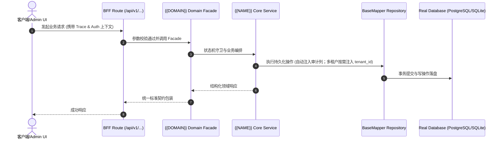

# Technical Architecture & Implementation Plan: {{TITLE}}

> **Spec-Kit 架构与技术实施方案 (ADD: Architecture & Design Document)**
> 上游真源：`spec.md` (或 `requirements.md`)。技术方案严格支撑需求，严禁反向变更业务目标。
> 状态：`PLAN_APPROVED` | 所属领域：`{{DOMAIN}}` | 规格标识：`{{NAME}}`
> 对应项目宪法：`.specify/memory/constitution.md` (Rule 0.2 模式复用 / Rule 0.6 真实测试驱动 / Rule 0.8 E2E 任务同等对齐)

---

## 1. 关键不变量与防御性约束 (Key Invariants & Guards)

{{INVARIANTS_SECTION}}

## 2. 领域架构边界与调用拓扑 (Architecture Topology & Flows)

{{ARCHITECTURE_OVERVIEW}}

### 核心业务时序图 (Archify Mermaid Flow)

## 3. 技术选型与多端建设交付范围 (Technical Selection & Multi-Terminal Scope)

### 3.1 蓝图底座与核心选型论证 (DAR)
- **交付底座**: 优先采用 `cooliebase-all` (Next.js 16 + React 19 轻全栈) 或 `yudao-quad-terminal` (Java 微服务 + Vue3 + UniApp + Expo)；纯独立项目经评审后采用 bare。
- **数据存储**: 真实数据库 (PostgreSQL / MySQL / SQLite)，100% 拒绝内存伪造 Mock。
- **多租户能力状态**: **底座可选特性，按需开启**。单租户或企业私有化部署项目缺省关闭，杜绝硬塞无用租户样板代码。

### 3.2 多端建设覆盖矩阵
- **B端管理中台 (Admin Web)**: 负责运营配置、数据检索、系统流转与核销审核。
- **C端用户门户/商城 (2C Web/H5)**: 客户/终端用户业务办理与自闭环体验（按需）。
- **原生移动端 (Expo / React Native App)**: 6 寸屏单手可达、移动巡检与离线业务（按需）。
- **微信小程序端 (Uni-App)**: 微信生态社交裂变、轻量化业务触达（按需）。

## 4. 数据模型与持久化契约 (Data Model & Tables)

实体结构遵循底座基础审计规范：
- `id` (主键)
- `tenant_id` (多租户标识 —— **底座可选特性，按需开启；单租户/企业私有化业务缺省**)
- `creator` / `create_time` (创建人/时间)
- `updater` / `update_time` (更新人/时间)
- `deleted` (逻辑删除标识)
- `version` (乐观锁版本号，按需)

### 涉及实体与变更说明
{{ENTITIES_SECTION}}

## 5. API 契约与权限体系 (API Contracts & Security)

{{API_CONTRACTS_SECTION}}

## 6. 状态机流转与边界守卫 (State Machine Transitions)

{{STATES_SECTION}}

## 7. 技术风险评估与缓解策略 (Technical Risks & Mitigations)

{{RISKS_SECTION}}
