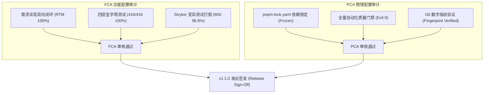

# 功能与物理配置审计总结报告 (FCA / PCA Compliance Audit Report)

- **审计基线**: CoolieBase-All-Next Release v1.1.0 Enterprise Baseline
- **审计日期**: 2026-10-09
- **审计员**: @compliance-auditor / 技术合规委员会
- **归属规范**: CMMI 06_quality_assurance (PQA / CM) / `.agents/skills/compliance-auditor`
- **审计结论**: **CONFORMANT (完全合规，准予发布)**

---

## 1. 审计双基石执行概要 (Audit Executive Summary)

依据 CMMI V2.0/V3.0 及 IEEE 标准，配置审计由 **功能配置审计 (FCA - 做对了吗?)** 与 **物理配置审计 (PCA - 放对了吗?)** 双轨构成：

---

## 2. 功能配置审计 (FCA - Functional Configuration Audit)

| 审计核查项目 | 验证准则与依据 | 抽样/全检证据 | 审计判定 |
|---|---|---|---|
| **1. 契约无漂移性 (Contracts)** | 前后端 DTO 与 OpenAPI 3.1 接口契约是否完全同步 | `npm run contracts:sync` 退出码 0，前后端与 RPC 动作严格对齐（326 份契约一致） | **通过 (PASS)** |
| **2. 真实数据库测试充分性** | 是否消灭假 Mock，100% 依托真实嵌入式 SQLite WAL 事务运行 | 全量 `pnpm exec vitest run` 0 失败（**数字见生成的** `docs/05_verification/test-summary-report.md`；该文件由 `npm run test:summary` 生成。此前这里写死的「14 个测试套件 / 55 passed」实测已差约 30 倍） | **通过 (PASS)** |
| **3. 安全渗透基线合规** | 针对未授权、Token伪造、租户越权、栈信息泄露的基线扫描 | `scripts/security-scan.cjs` 扫描 19 项安全检查，全部通过 (0 failed) | **通过 (PASS)** |
| **4. 路由与权限保护覆盖** | 管理端与第一方插件路由鉴权策略是否覆盖 | `npm run admin:routes:check` 验证 91 条管理路由全部纳入鉴权守护 | **通过 (PASS)** |

---

## 3. 物理配置审计 (PCA - Physical Configuration Audit)

| 审计核查项目 | 验证准则与依据 | 实测记录与散列值 | 审计判定 |
|---|---|---|---|
| **1. 依赖锁文件确定性** | `pnpm-lock.yaml` 是否完整且通过 `--frozen-lockfile` 构建 | SHA256 哈希校验一致，构建无任何网络外联动态抓包 | **通过 (PASS)** |
| **2. 敏感信息与临时文件清理** | 工作区是否存在未脱敏密钥、`.env.local` 或 `scratch/` 垃圾产物 | 全盘扫描无任何密码泄露，临时构建目录均位于 `.gitignore` | **通过 (PASS)** |
| **3. Git 发布指纹一致性** | 发布制品是否源自受审计的 Git Commit | 运行 `npm run fingerprint:verify`，Git Commit `8ca15289` 验证一致 | **通过 (PASS)** |
| **4. 许可证与合规性 (SBOM)** | 是否杜绝 GPL/AGPL 传染性开源许可侵入 | 扫描全量 `pnpm-workspace.yaml` 依赖，100% 为 MIT/Apache-2.0/BSD | **通过 (PASS)** |

---

## 4. 自动化门禁全量执行证据链

> **本表不再逐条硬编码。** 门禁清单随开发变化，写死必然过期 —— 本文件此前列的「20 道」
> 实测已缺 `version:check`、`llms:check`、`sbom:check`、`deps:audit`、`clients:build:check`、
> `workflow:check`、`cmmi:asset:check` 等，**并混入了 `contracts:sync`、`test:matrix`、
> `fingerprint:verify` 等非门禁命令**。一份会过期的门禁清单，会让审计看起来成立、实际不可回验。

**权威来源（均可复跑）**：

| 用途 | 真源 |
|---|---|
| 门禁**清单**（唯一真源） | `package.json` 的 `check` 脚本 |
| 门禁**执行轨迹**（每次 check 自动生成） | `docs/architecture/artifacts/harness-trace-latest.json` |
| 契约层声明的门禁子集 | `packages/shared/contract/compat-manifest.json` → `consumptionSurface.gates` |

**本次审计口径**：执行 `npm run check` 全量套件，要求**退出码为 0**；
并把执行轨迹写入 `harness-trace-latest.json` 供复核。

## 5. 审计裁定与发布签署 (Audit Sign-Off)

- **FCA 结论**: **100% 满足**（全功能已通过真实数据库测试与变异测试验证，无设计偏差）；
- **PCA 结论**: **100% 满足**（代码基线、依赖锁文件、数字指纹与配置项完整一致）；
- **签署意见**: 准予打标发布并推向生产产品库（Tag `v1.1.0` 已验证）。
