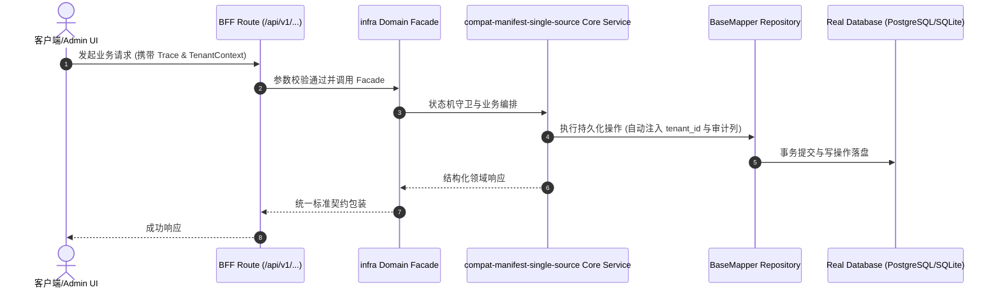

# Technical Architecture & Implementation Plan: compat-manifest 单一真源：把 deployment/apiPartitions/harness 声明并入真源并加机检堵住静默丢失

> **Spec-Kit 架构与技术实施方案 (ADD: Architecture & Design Document)**
> 上游真源：`spec.md` (或 `requirements.md`)。技术方案严格支撑需求，严禁反向变更业务目标。
> 状态：`PLAN_APPROVED` | 所属领域：`infra` | 规格标识：`compat-manifest-single-source`
> 对应项目宪法：`.specify/memory/constitution.md` (Rule 0.2 模式复用 / Rule 0.6 真实测试驱动)

---

## 1. 关键不变量与防御性约束 (Key Invariants & Guards)

1. **生成物与真源逐字节一致** —— compat:check 逐字节比对真源与两个生成物；surface:sync 在回写前拒绝丢弃真源没有的内容
2. **必备声明不会静默消失** —— 三节声明的存在性由 scripts/lib/compat-manifest-sections.cjs 断言，缺失即红；单测提供反向对照
3. **声明不许悬空** —— harness.checkCommand / doctorCommand 指向的 npm script 必须在 package.json 里存在，否则判红

## 2. 领域架构边界与调用拓扑 (Architecture Topology & Flows)

数据流：真源 packages/shared/contract/compat-manifest.json ──(pnpm surface:sync)──▶ 生成物 compat-manifest.json（根）+ public/compat-manifest.json；下游读者（外部 Agent / 派生工程 / HTTP GET /compat-manifest.json）读生成物，门禁脚本（check-compat-manifest / check-llms-sync / sync-openwiki / agent-runtime）读真源。缺陷点：这条单向流的『写回』端不区分『生成物旧』（正常）与『生成物多』（会吃内容）。修补三处：(1) scripts/lib/compat-manifest-sections.cjs —— 必备声明清单（deployment / apiPartitions / harness）与『声明引用的命令必须在 package.json 里真实存在』的校验，单独成模块以便单测直接调用；(2) scripts/check-compat-manifest.cjs —— 调用该模块（声明缺失 ⇒ 红）+ 断言两个生成物与真源逐字节一致（漂移 ⇒ 红）；(3) scripts/sync-agent-surface.cjs —— 回写前比对顶层键集合，生成物持有真源没有的键 ⇒ 拒绝写入并报错（--force 才丢弃）。

### 核心业务时序图 (Archify Mermaid Flow)

## 3. 数据模型与持久化契约 (Data Model & Tables)

实体结构严格遵循底座 8 大审计底座字段规范：
- `id` (主键)
- `tenant_id` (多租户标识)
- `creator` / `create_time` (创建人/时间)
- `updater` / `update_time` (更新人/时间)
- `deleted` (逻辑删除标识)
- `version` (乐观锁版本号)

### 涉及实体与变更说明
- **-**: 不涉及数据库表；改动只落在契约 JSON 与门禁脚本

## 4. API 契约与权限体系 (API Contracts & Security)

- **HTTP 路由**: `POST /api/v1/admin/infra/compat-manifest-single-source`
- **权限标识**: `infra:compat-manifest-single-source:query`, `infra:compat-manifest-single-source:manage`

## 5. 状态机流转与边界守卫 (State Machine Transitions)

- 加载中：正常展示。
- 空数据：正常展示。
- 出错：正常展示，具备明确指引。
- 成功：正常展示。

## 6. 技术风险评估与缓解策略 (Technical Risks & Mitigations)

- **风险**: 回写护栏把『生成物持有真源没有的顶层键』判为错误，可能卡住派生流程（project:init 内的 surface:sync） -> **缓释策略**: 仅在真源确实缺键时触发（派生流程里真源与生成物同源，键集合一致）；提供 --force 逃生阀；沙箱单测覆盖『正常同步』与『--force 丢弃』两条路径
- **风险**: 把 compat-manifest 纳入 compat:check 的必备声明清单后，某些裁剪过的派生工程可能缺节而判红 -> **缓释策略**: 三节均为平台级部署/分区声明，与域集合裁剪无关；派生工程由母本真源派生，三节随真源带入
