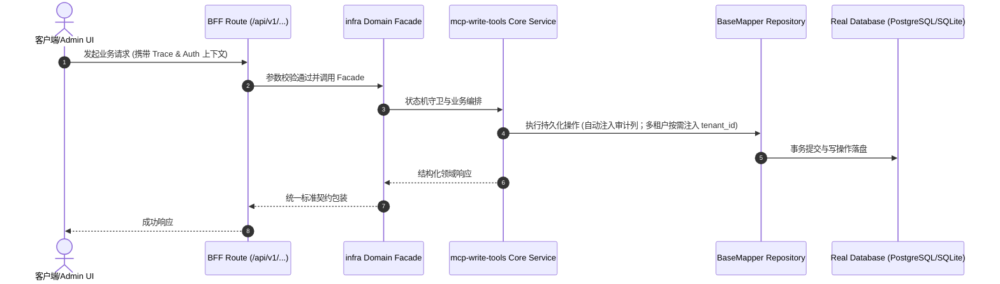

# Technical Architecture & Implementation Plan: 低代码 MCP 写类工具（B1 二期）：scaffold.plan / codegen.preview

> **Spec-Kit 架构与技术实施方案 (ADD: Architecture & Design Document)**
> 上游真源：`spec.md` (或 `requirements.md`)。技术方案严格支撑需求，严禁反向变更业务目标。
> 状态：`PLAN_APPROVED` | 所属领域：`infra` | 规格标识：`mcp-write-tools`
> 对应项目宪法：`.specify/memory/constitution.md` (Rule 0.2 模式复用 / Rule 0.6 真实测试驱动 / Rule 0.8 E2E 任务同等对齐)

---

## 1. 关键不变量与防御性约束 (Key Invariants & Guards)

1. **不落盘不变量** —— 所有新增工具走 dry-run 分支；测试断言调用后 git status 无变化，且工具签名不接受 write 类入参
2. **白名单域不变量** —— 域名一律经 scripts/lib/domain-catalog.cjs 解析并校验 catalog 登记状态，未登记域直接拒绝而非兜底生成

## 2. 领域架构边界与调用拓扑 (Architecture Topology & Flows)

在 scripts/mcp/cooliebase-mcp-server.cjs 的 tools 注册表新增 3 个工具；逐一薄封装既有入口：scaffold.plan 复用 scripts/create-business-domain.ts 的 dry-run（默认即 dry-run，--write 才落盘）；codegen.preview 复用 cooliebase_codegen_targets 已有的域目录解析（scripts/lib/domain-catalog.cjs 的 domainDirOf）叠加 inject-codegen-output.cjs --dry-run；tables.migration.plan 复用 scripts/generate-table-migration.ts 并显式拒绝 --write 入参。统一返回契约 { plannedWrites: string[], followUpGates: string[], manualSteps: string[] }。延续 B1 一期零依赖 stdio 实现，不 import Next 侧或 codegen service 运行时代码。

### 核心业务时序图 (Archify Mermaid Flow)

## 3. 技术选型与多端建设交付范围 (Technical Selection & Multi-Terminal Scope)

### 3.1 蓝图底座与核心选型论证 (DAR)
- **交付底座**: 优先采用 `cooliebase-all` (Next.js 16 + React 19 轻全栈) 或 `yudao-quad-terminal` (Java 微服务 + Vue3 + UniApp + Expo)；纯独立项目经评审后采用 bare。
- **数据存储**: 真实数据库 (PostgreSQL / MySQL / SQLite)，100% 拒绝内存伪造 Mock。
- **多租户能力状态**: **底座可选特性，按需开启**。单租户或企业私有化部署项目缺省关闭，杜绝硬塞无用租户样板代码。

### 3.2 多端建设覆盖矩阵
- **B端管理中台 (Admin Web)**: 负责运营配置、数据检索、系统流转与核销审核。
- **C端用户门户/商城 (2C Web/H5)**: 客户/终端用户业务办理与自闭环体验（按需）。
- **原生移动端 (Expo / React Native App)**: 6 寸屏单手可达、移动巡检与离线业务（按需）。
- **微信小程序端 (Uni-App)**: 微信生态社交裂变、轻量化业务触达（按需）。

## 4. 数据模型与持久化契约 (Data Model & Tables)

实体结构遵循底座基础审计规范：
- `id` (主键)
- `tenant_id` (多租户标识 —— **底座可选特性，按需开启；单租户/企业私有化业务缺省**)
- `creator` / `create_time` (创建人/时间)
- `updater` / `update_time` (更新人/时间)
- `deleted` (逻辑删除标识)
- `version` (乐观锁版本号，按需)

### 涉及实体与变更说明
- **-**: 本次不涉及数据库表；MCP 工具清单真源为 packages/shared/contract/compat-manifest.json

## 5. API 契约与权限体系 (API Contracts & Security)

- **HTTP 路由**: `POST /api/v1/admin/infra/mcp-write-tools`
- **权限标识**: `infra:mcp-write-tools:query`, `infra:mcp-write-tools:manage`

## 6. 状态机流转与边界守卫 (State Machine Transitions)

- 加载中：不涉及（stdio 同步应答）。
- 空数据：计划为空时返回空 plannedWrites 并说明原因，不报错。
- 出错：未登记域/越权路径返回明确错误码与原因，不静默兜底。
- 成功：返回 plannedWrites + followUpGates + manualSteps 三段结构。

## 7. 技术风险评估与缓解策略 (Technical Risks & Mitigations)

- **风险**: 写类工具被误当作落盘通道使用，导致 Agent 绕过人工确认改仓 -> **缓释策略**: 结构化返回计划而非执行；签名不收 write 入参；测试显式断言 git status 不变
- **风险**: compat-manifest 与 MCP 服务出现第二真源（工具清单不一致） -> **缓释策略**: compat:check 交叉校验，并配负向测试（人为制造漂移须被拦下）
