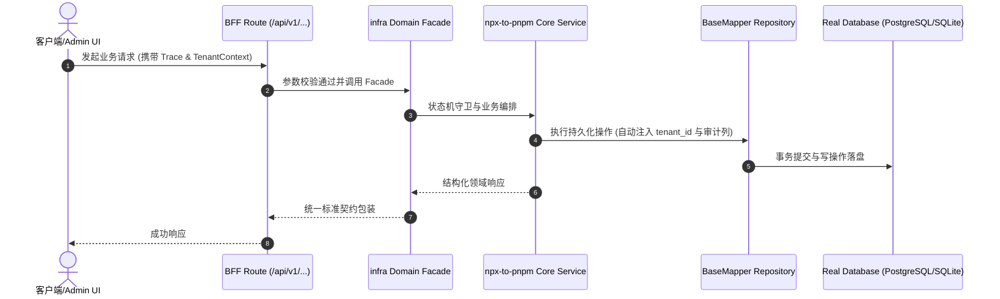

# Technical Architecture & Implementation Plan: 统一包管理器调用：仓内 npx 全部改为 pnpm exec / pnpm dlx

> **Spec-Kit 架构与技术实施方案 (ADD: Architecture & Design Document)**
> 上游真源：`spec.md` (或 `requirements.md`)。技术方案严格支撑需求，严禁反向变更业务目标。
> 状态：`PLAN_APPROVED` | 所属领域：`infra` | 规格标识：`npx-to-pnpm`
> 对应项目宪法：`.specify/memory/constitution.md` (Rule 0.2 模式复用 / Rule 0.6 真实测试驱动)

---

## 1. 关键不变量与防御性约束 (Key Invariants & Guards)

1. **行为等价** —— 替换后逐个跑受影响脚本的用例/门禁，确认输出与通过状态不变

## 2. 领域架构边界与调用拓扑 (Architecture Topology & Flows)

<!-- 待填: 目标分层架构图与依赖倒置示意 -->

### 核心业务时序图 (Archify Mermaid Flow)

## 3. 数据模型与持久化契约 (Data Model & Tables)

实体结构严格遵循底座 8 大审计底座字段规范：
- `id` (主键)
- `tenant_id` (多租户标识)
- `creator` / `create_time` (创建人/时间)
- `updater` / `update_time` (更新人/时间)
- `deleted` (逻辑删除标识)
- `version` (乐观锁版本号)

### 涉及实体与变更说明
- **<!-- 待填: 涉及的表名 -->**: <!-- 待填 -->

## 4. API 契约与权限体系 (API Contracts & Security)

- **HTTP 路由**: `POST /api/v1/admin/infra/npx-to-pnpm`
- **权限标识**: `infra:npx-to-pnpm:query`, `infra:npx-to-pnpm:manage`

## 5. 状态机流转与边界守卫 (State Machine Transitions)

- 加载中：正常展示。
- 空数据：正常展示。
- 出错：正常展示。
- 成功：正常展示。

## 6. 技术风险评估与缓解策略 (Technical Risks & Mitigations)

- **风险**: `pnpm exec` 在子进程的不同 cwd 下可能解析不到二进制 -> **缓释策略**: 改完立刻跑 clients:build:check 与 MCP 用例；发现解析问题则显式指定工作目录
