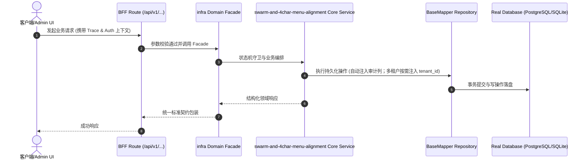

# Technical Architecture & Implementation Plan: SWARM多智能体协同法典、8动词service.sh与4字菜单门禁对齐

> **Spec-Kit 架构与技术实施方案 (ADD: Architecture & Design Document)**
> 上游真源：`spec.md` (或 `requirements.md`)。技术方案严格支撑需求，严禁反向变更业务目标。
> 状态：`PLAN_APPROVED` | 所属领域：`infra` | 规格标识：`swarm-and-4char-menu-alignment`
> 对应项目宪法：`.specify/memory/constitution.md` (Rule 0.2 模式复用 / Rule 0.6 真实测试驱动 / Rule 0.8 E2E 任务同等对齐)

---

## 1. 关键不变量与防御性约束 (Key Invariants & Guards)

1. **单写者与只读独立核验** —— SWARM.md 明确规定同一波次文件白名单互斥、跨域只走 Domain Facade、Wave 4 Verifier 只读实测后签发 [SEALED]。
2. **层 B 三件套可执行闭环** —— HARNESS.md + scripts/harness.cjs + scripts/service.sh (及 deploy/service.sh) 完整覆盖 8 动词，且支持 .env.ports 动态端口。
3. **新增可见菜单 <=4 字刚性防线** —— menu-title-guard.cjs 对所有非基线冻结的新增菜单执行 <=4 字硬拦截，反向对照单测注入 5 字菜单必须返回违规。

## 2. 领域架构边界与调用拓扑 (Architecture Topology & Flows)

1) 根级 SWARM.md 定义 CoolieBase-All 多智能体协同拓扑（Wave 0 契约底座 -> Wave 1 后端插件与 Domain Facade -> Wave 2 B/C/Expo 多端 UI -> Wave 3 真 PG 18.4 E2E -> Wave 4 独立只读 Verifier），并在 scripts/clone-project-base.cjs 的 PROTECTED_DOCS 中保护 SWARM.md 与 GOAL.md；2) scripts/service.sh 读取 .env.ports / .env.local / .env 端口契约，实现 8 标准动词并由 deploy/service.sh 同源委托、scripts/harness.cjs GROUPS.service 统一纳管；3) scripts/lib/menu-title-guard.cjs 提供可见菜单字数统计与冻结棘轮比对，同时接入 scripts/generate-admin-nav.cjs --check 与 scripts/blueprint-engine.cjs 自愈编译器。

### 核心业务时序图 (Archify Mermaid Flow)

## 3. 技术选型与多端建设交付范围 (Technical Selection & Multi-Terminal Scope)

### 3.1 蓝图底座与核心选型论证 (DAR)
- **交付底座**: 优先采用 `cooliebase-all` (Next.js 16 + React 19 轻全栈) 或 `yudao-quad-terminal` (Java 微服务 + Vue3 + UniApp + Expo)；纯独立项目经评审后采用 bare。
- **数据存储**: 真实数据库 (PostgreSQL / MySQL / SQLite)，100% 拒绝内存伪造 Mock。
- **多租户能力状态**: **底座可选特性，按需开启**。单租户或企业私有化部署项目缺省关闭，杜绝硬塞无用租户样板代码。

### 3.2 多端建设覆盖矩阵
- **B端管理中台 (Admin Web)**: 负责运营配置、数据检索、系统流转与核销审核。
- **C端用户门户/商城 (2C Web/H5)**: 客户/终端用户业务办理与自闭环体验（按需）。
- **原生移动端 (Expo / React Native App)**: 6 寸屏单手可达、移动巡检与离线业务（按需）。
- **微信小程序端 (Uni-App)**: 微信生态社交裂变、轻量化业务触达（按需）。

## 4. 数据模型与持久化契约 (Data Model & Tables)

实体结构遵循底座基础审计规范：
- `id` (主键)
- `tenant_id` (多租户标识 —— **底座可选特性，按需开启；单租户/企业私有化业务缺省**)
- `creator` / `create_time` (创建人/时间)
- `updater` / `update_time` (更新人/时间)
- `deleted` (逻辑删除标识)
- `version` (乐观锁版本号，按需)

### 涉及实体与变更说明
- **-**: 纯工程治理、服务控制面与导航编译门禁资产，无新增数据库表

## 5. API 契约与权限体系 (API Contracts & Security)

- **HTTP 路由**: `POST /api/v1/admin/infra/swarm-and-4char-menu-alignment`
- **权限标识**: `infra:swarm-and-4char-menu-alignment:query`, `infra:swarm-and-4char-menu-alignment:manage`

## 6. 状态机流转与边界守卫 (State Machine Transitions)

- service status Running：PID 存活且端口监听正常。
- service status Stopped：无残留僵尸进程。
- menu-title-guard Pass：0 新增超 4 字可见菜单。
- menu-title-guard Fail：检测到未在冻结基线中的 >4 字菜单，输出修复指引并 exit 1。

## 7. 技术风险评估与缓解策略 (Technical Risks & Mitigations)

- **风险**: 历史导入的 340 张源表菜单名称普遍超过 4 个汉字，直接一刀切会导致存量门禁与页面断言全红 -> **缓释策略**: 采用 docs/architecture/artifacts/menu-title-length-baseline.json 冻结历史存量超长菜单，只对新增菜单与新蓝图实体强制 <=4 字；蓝图实体支持显式 menuTitle 或自动裁剪后缀收敛
- **风险**: 新增 package.json 脚本若未挂入 scripts/harness.cjs 会触发 harness:integrity:check 不可达脚本门禁失败 -> **缓释策略**: 将 service:install 与 service:build 同步登记至 scripts/harness.cjs 的 GROUPS.service，保持不可达脚本数为 0
