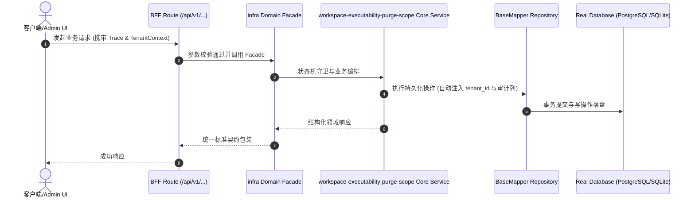

# Technical Architecture & Implementation Plan: 派生后可执行性门禁口径对齐平台 cleanWorkspaceLeaks 全量清洗面（补 package.json 维度）

> **Spec-Kit 架构与技术实施方案 (ADD: Architecture & Design Document)**
> 上游真源：`spec.md` (或 `requirements.md`)。技术方案严格支撑需求，严禁反向变更业务目标。
> 状态：`PLAN_APPROVED` | 所属领域：`infra` | 规格标识：`workspace-executability-purge-scope`
> 对应项目宪法：`.specify/memory/constitution.md` (Rule 0.2 模式复用 / Rule 0.6 真实测试驱动)

---

## 1. 关键不变量与防御性约束 (Key Invariants & Guards)

1. **口径不得比平台清洗面窄** —— resolvePurgeTargets() 比对生效口径与 PLATFORM_CLEAN_SURFACE，缺条目即以 purge-scope-narrower-than-platform 判红（口径收窄 = 门禁变弱 = 假绿）
2. **公开 script 键不得被清洗后静默消失** —— auditPackageJson() 断言 harness / speckit 必须在 package.json 中；缺失即 public-script-key-missing 判红
3. **公开脚本不得依赖任何会被清洗的文件** —— 静态层同时扫 require/import 依赖与路径字面量依赖（exec / spawn / readFile 形态），命中清洗面即判红
4. **偏严只多红、不假绿** —— 按来源鉴别的条目（scripts/speckit.cjs、scripts/lib/spec-resolver.cjs 等）保守全列；底座母本当前不含这 6 个文件 ⇒ 本仓无假红

## 2. 领域架构边界与调用拓扑 (Architecture Topology & Flows)

数据流：平台 server/src/services/harness-delivery-engine.ts 的 cleanWorkspaceLeaks（清洗面 + package.json 改写） ──镜像──▶ 底座 scripts/lib/workspace-executability-scope.cjs（口径单一真源，常量 + resolvePurgeTargets + auditPackageJson） ──消费──▶ 底座 scripts/check-workspace-executability.cjs（静态层：相对依赖解析 + 路径字面量依赖 + package.json 维度 + 口径收窄自检；运行层：真跑公开命令探针） ──产出──▶ --run --json 报告（kind=workspace-executability-report，failures/warnings/probes） ──透传──▶ 平台 packages/harness/src/delivery/workspace-executability.ts 的 runWorkspaceExecutabilitySmoke（主路径 source=workspace-gate；门禁缺席时退回 platform-static 静态兜底）。依赖方向单向：平台 → 口径真源 → 门禁脚本 → 报告；平台**不** import 底座实现（只透传命令与解析 JSON），口径真源单独成模块以便单测直接调用。

### 核心业务时序图 (Archify Mermaid Flow)

## 3. 数据模型与持久化契约 (Data Model & Tables)

实体结构严格遵循底座 8 大审计底座字段规范：
- `id` (主键)
- `tenant_id` (多租户标识)
- `creator` / `create_time` (创建人/时间)
- `updater` / `update_time` (更新人/时间)
- `deleted` (逻辑删除标识)
- `version` (乐观锁版本号)

### 涉及实体与变更说明
- **-**: 不涉及数据库表；改动只落在门禁脚本、口径真源模块、单测与文档

## 4. API 契约与权限体系 (API Contracts & Security)

- **HTTP 路由**: `POST /api/v1/admin/infra/workspace-executability-purge-scope`
- **权限标识**: `infra:workspace-executability-purge-scope:query`, `infra:workspace-executability-purge-scope:manage`

## 5. 状态机流转与边界守卫 (State Machine Transitions)

- 加载中：不涉及。
- 空数据：不涉及。
- 出错：门禁以 exit 1 + 逐条失败项（kind/file:line/detail）输出，不静默吞掉。
- 无权限：不涉及。

## 6. 技术风险评估与缓解策略 (Technical Risks & Mitigations)

- **风险**: 保守口径（按来源鉴别的 6 条全列）在底座母本产生假红 -> **缓释策略**: 已机检：母本与派生工作区均不含这 6 个文件（scripts/speckit.cjs、scripts/check-contracts.mjs、scripts/lib/spec-resolver.cjs、scripts/lib/spec-ontology-driver.cjs、scripts/lib/speckit-issue-verifier.cjs、scripts/lib/ontology-callchain-engine.cjs）⇒ 本仓零假红；口径注释写清「平台已改来源鉴别」，避免下一个维护者照过期事实决策
- **风险**: 平台清洗面继续扩张 ⇒ 底座口径再次落后（口径收窄 = 假绿） -> **缓释策略**: 口径真源是单一常量文件，且有 purge-scope-narrower-than-platform 自判红 + 反向对照单测；平台侧口径变更时只需改该常量并跑单测
- **风险**: 刷新母本快照会影响之后所有新建客户工作区的模板版本 -> **缓释策略**: 刷新只带入门禁脚本与口径真源（不改任何 npm script / 域 / 对外契约）；刷新后立即重跑一次派生冒烟，好样本应绿
