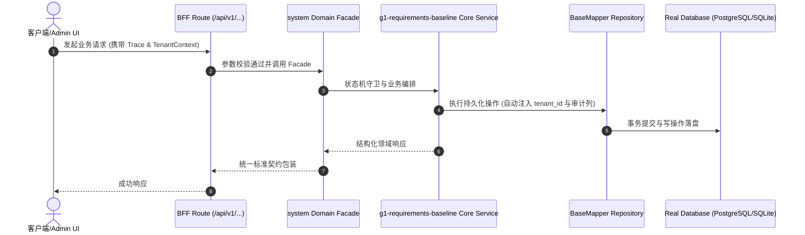

# Technical Architecture & Implementation Plan: G1 需求门禁 · EARS 需求基线（Spec-Kit SRS）

> **Spec-Kit 架构与技术实施方案 (ADD: Architecture & Design Document)**
> 上游真源：`spec.md` (或 `requirements.md`)。技术方案严格支撑需求，严禁反向变更业务目标。
> 状态：`PLAN_APPROVED` | 所属领域：`system` | 规格标识：`g1-requirements-baseline`
> 对应项目宪法：`.specify/memory/constitution.md` (Rule 0.2 模式复用 / Rule 0.6 真实测试驱动)

---

## 1. 关键不变量与防御性约束 (Key Invariants & Guards)

1. **无占位符基线** —— 任何进入门禁的规格 requirements.md 必须零『待填』占位注释；check-delivery.cjs inspectFeatureDocs 以占位注释计数一票否决
2. **单一真源防漂移** —— 需求变更只允许修改 brief.json 后重新 build 渲染；直接改渲染产物即视为基线漂移，check 阶段判红
3. **数字可追溯** —— 每条性能/可用性数字（如 26,877 RPS 容量护栏、P95 ≤ 20ms）必须标注度量方式与实测日期，无实测则留空

## 2. 领域架构边界与调用拓扑 (Architecture Topology & Flows)

需求真源分布在各规格 docs/specs/<域>/<名>/brief.json（<500 Tokens 声明式），由 scripts/speckit.ts 渲染流水线展开为 docs/specs/<域>/<名>/ 下 requirements.md 等 8 类阶段文档；scripts/check-delivery.cjs 作为 G1 门禁判定器读取渲染产物与 evidence.json 输出退出码。

### 核心业务时序图 (Archify Mermaid Flow)

## 3. 数据模型与持久化契约 (Data Model & Tables)

实体结构严格遵循底座 8 大审计底座字段规范：
- `id` (主键)
- `tenant_id` (多租户标识)
- `creator` / `create_time` (创建人/时间)
- `updater` / `update_time` (更新人/时间)
- `deleted` (逻辑删除标识)
- `version` (乐观锁版本号)

### 涉及实体与变更说明
- **-**: 本规格为需求工程治理增强，不涉及新增业务数据库表

## 4. API 契约与权限体系 (API Contracts & Security)

- **HTTP 路由**: `POST /api/v1/admin/system/g1-requirements-baseline`
- **权限标识**: `system:g1-requirements-baseline:query`, `system:g1-requirements-baseline:manage`

## 5. 状态机流转与边界守卫 (State Machine Transitions)

- 加载中：不适用
- 空数据：无实测数据的 NFR 指标保持严格留空
- 出错：门禁检出占位符或缺项时退出码非 0 阻断流水线
- 成功：exit=0 且 list 状态 PLAN_APPROVED

## 6. 技术风险评估与缓解策略 (Technical Risks & Mitigations)

- **风险**: 需求基线与实现脱节漂移（文档腐化） -> **缓释策略**: 单一真源 brief.json + check-delivery 占位符一票否决 + No Artifact No Done 门禁链
- **风险**: EARS 句式执行不严格导致验收准则不可测试 -> **缓释策略**: 验收准则强制『THE system SHALL 验证 + 可执行命令 + 预期退出码』格式，QA 逐条转断言
