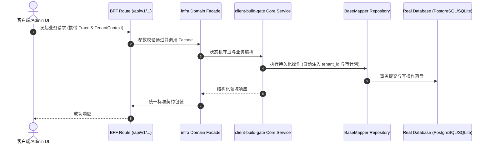

# Technical Architecture & Implementation Plan: 客户端构建门禁（Expo 导出）+ Expo SDK 升级路径评估

> **Spec-Kit 架构与技术实施方案 (ADD: Architecture & Design Document)**
> 上游真源：`spec.md` (或 `requirements.md`)。技术方案严格支撑需求，严禁反向变更业务目标。
> 状态：`PLAN_APPROVED` | 所属领域：`infra` | 规格标识：`client-build-gate`
> 对应项目宪法：`.specify/memory/constitution.md` (Rule 0.2 模式复用 / Rule 0.6 真实测试驱动)

---

## 1. 关键不变量与防御性约束 (Key Invariants & Guards)

1. **零污染** —— 导出始终指向临时目录，且 finally 中清理；调用前后 git status 必须一致
2. **裁剪不失败** —— clients/** 缺席即跳过（exit 0 + 原因），保证 profile base/minimal 孵化的工程不会因缺少客户端而红

## 2. 领域架构边界与调用拓扑 (Architecture Topology & Flows)

新增 `scripts/check-client-build.cjs`：① 若 `clients/expo` 或其 `node_modules` 不存在 → 打印跳过原因并 exit 0；② 否则在 `os.tmpdir()` 下建唯一临时目录，以 `cwd=clients/expo` 执行 `pnpm exec expo export -p web --output-dir <tmp>`；③ 断言退出码 0、`<tmp>/index.html` 存在、`_expo/static/js/web/` 下至少一个 `.js`；④ 无论成败都在 finally 里删除临时目录；⑤ 输出结构化结果（跳过/通过/失败 + 耗时 + 产物数），失败时打印导出日志尾部。接线：`npm run clients:build:check` 插入 `npm run check` 链，并在 `write-harness-trace.cjs` 的 gates 与 `compat-manifest.json` 的 `consumptionSurface.gates` 同步声明。

### 核心业务时序图 (Archify Mermaid Flow)

## 3. 数据模型与持久化契约 (Data Model & Tables)

实体结构严格遵循底座 8 大审计底座字段规范：
- `id` (主键)
- `tenant_id` (多租户标识)
- `creator` / `create_time` (创建人/时间)
- `updater` / `update_time` (更新人/时间)
- `deleted` (逻辑删除标识)
- `version` (乐观锁版本号)

### 涉及实体与变更说明
- **-**: 不涉及数据库表；门禁实现为 scripts/check-client-build.cjs，无持久化产物

## 4. API 契约与权限体系 (API Contracts & Security)

- **HTTP 路由**: `POST /api/v1/admin/infra/client-build-gate`
- **权限标识**: `infra:client-build-gate:query`, `infra:client-build-gate:manage`

## 5. 状态机流转与边界守卫 (State Machine Transitions)

- 加载中：不涉及。
- 空数据：无客户端 → 跳过并打印原因，exit 0。
- 出错：导出失败 → exit 非 0 并打印日志尾部，不静默通过。
- 成功：打印耗时与产物数量，exit 0。

## 6. 技术风险评估与缓解策略 (Technical Risks & Mitigations)

- **风险**: Expo 导出在 CI（linux）与本机（darwin）行为不同，门禁可能在 CI 红 -> **缓释策略**: 门禁只断言退出码与产物存在，不断言字节内容；失败时打印导出日志尾部便于定位
- **风险**: 门禁耗时随客户端规模增长，拖慢 check -> **缓释策略**: 实测当前约十几秒（Metro 打包 4.2s）；若显著增长，再按仓内既有做法（smoke/security/load）拆为独立 job
