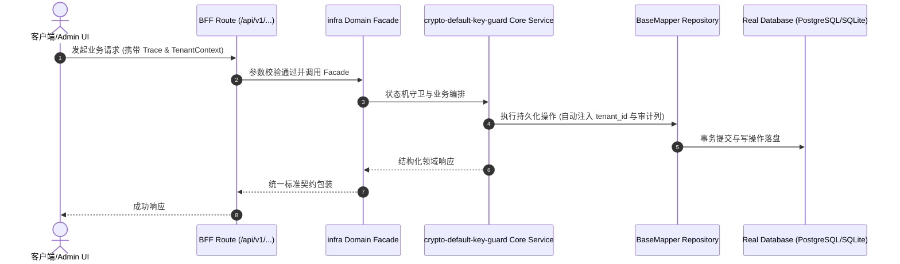

# Technical Architecture & Implementation Plan: 生产环境必须禁止使用硬编码默认 AES 密钥

> **Spec-Kit 架构与技术实施方案 (ADD: Architecture & Design Document)**
> 上游真源：`spec.md` (或 `requirements.md`)。技术方案严格支撑需求，严禁反向变更业务目标。
> 状态：`PLAN_APPROVED` | 所属领域：`infra` | 规格标识：`crypto-default-key-guard`
> 对应项目宪法：`.specify/memory/constitution.md` (Rule 0.2 模式复用 / Rule 0.6 真实测试驱动)

---

## 1. 关键不变量与防御性约束 (Key Invariants & Guards)

1. **生产不许静默降级** —— NODE_ENV=production 且缺密钥 → 抛错；由子进程行为测试守。
2. **构建不被破坏** —— 守卫只在调用时触发；由「import 不调用不报错」守。

## 2. 领域架构边界与调用拓扑 (Architecture Topology & Flows)

两个模块都在模块级把 env 值兜底成硬编码常量：
· `packages/shared/backend/lib/crypto-engine.ts:21` → `COOLIEBASE_SHARED_AES_KEY || "cooliebase-all-default-aes-key!!"`
· `packages/shared/backend/lib/crypto-vault.ts:4` → `COOLIEBASE_VAULT_AES_KEY || "0123456789abcdef…"`
且这两个变量**在全仓别处都没有出现**（`.env` / 文档 / 部署脚本都没有）→ 生产漏配不会被任何人提醒，
加密照常『成功』，只是用的是一把公开钥匙。

改法：把默认值从**模块级常量**改成**调用时的解析函数**（`resolveKey()`），
在生产且未设密钥时抛错；错误信息点名变量与用途。
调用点：`crypto-engine` 的 `encrypt/decrypt`；`crypto-vault` 的 `encrypt/decrypt/encryptJson/decryptJson`（都用 `key = DEFAULT_KEY` 默认参数）。

### 核心业务时序图 (Archify Mermaid Flow)

## 3. 数据模型与持久化契约 (Data Model & Tables)

实体结构严格遵循底座 8 大审计底座字段规范：
- `id` (主键)
- `tenant_id` (多租户标识)
- `creator` / `create_time` (创建人/时间)
- `updater` / `update_time` (更新人/时间)
- `deleted` (逻辑删除标识)
- `version` (乐观锁版本号)

### 涉及实体与变更说明
- **-**: 本规格不新增或修改任何表。

## 4. API 契约与权限体系 (API Contracts & Security)

- **HTTP 路由**: `POST /api/v1/admin/infra/crypto-default-key-guard`
- **权限标识**: `infra:crypto-default-key-guard:query`, `infra:crypto-default-key-guard:manage`

## 5. 状态机流转与边界守卫 (State Machine Transitions)

## 6. 技术风险评估与缓解策略 (Technical Risks & Mitigations)

- **风险**: 守卫放在模块加载时会导致 `next build` 失败（NODE_ENV=production）。 -> **缓释策略**: 守卫放调用时；并用「只 import 不调用 → 不抛错」的用例锁住这一点。
- **风险**: 把现有部署打挂：若某环境确实没配密钥，上线后加密调用会立刻抛错。 -> **缓释策略**: 这正是本规格的目的（宁可炸也不要静默用公开钥匙）；同时在 `.env.example` 与文档里补上变量说明，并让错误信息给出确切变量名。
