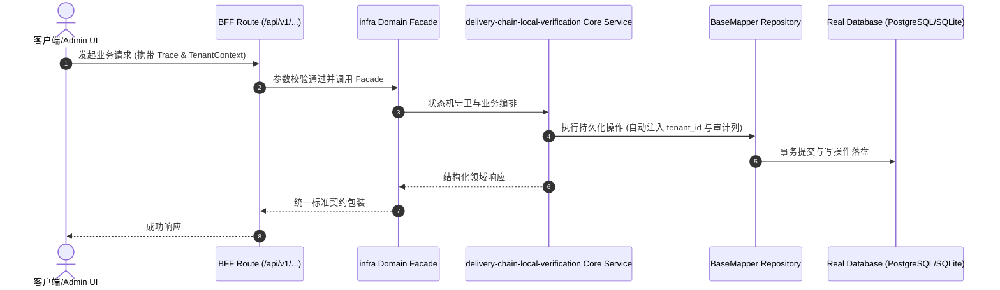

# Technical Architecture & Implementation Plan: 交付链三件套本地可验证（smoke/security/load）

> **Spec-Kit 架构与技术实施方案 (ADD: Architecture & Design Document)**
> 上游真源：`spec.md` (或 `requirements.md`)。技术方案严格支撑需求，严禁反向变更业务目标。
> 状态：`PLAN_APPROVED` | 所属领域：`infra` | 规格标识：`delivery-chain-local-verification`
> 对应项目宪法：`.specify/memory/constitution.md` (Rule 0.2 模式复用 / Rule 0.6 真实测试驱动)

---

## 1. 关键不变量与防御性约束 (Key Invariants & Guards)

1. **检查集不可被静默降级** —— 不可达必须非 0 退出；SKIP 只能由显式环境开关触发，且输出必须可见
2. **无残留** —— 隧道进程与临时数据库在 finally 中清理，并轮询验证端口释放

## 2. 领域架构边界与调用拓扑 (Architecture Topology & Flows)

选定方案 A：**脚本内置「数据库端点解析 + 自管理 SSH 隧道」**。解析顺序：① `localhost:5433` 可达 → 直接连接；② 否则若 `colima` 在运行且 `colima ssh-config` 可用 → 建立 `ssh -F <config> -N -L 127.0.0.1:<空闲端口>:127.0.0.1:5433 colima`，把 PGHOST/PGPORT 指向隧道；③ 都不满足 → fail-loud 并给出修复指引。三件套改从 `scripts/lib/pg-endpoint.cjs` 取端点（消除 5433 硬编码），隧道在进程退出时关闭并**轮询确认端口释放**。实测该隧道 1 秒内可用。

### 核心业务时序图 (Archify Mermaid Flow)

## 3. 数据模型与持久化契约 (Data Model & Tables)

实体结构严格遵循底座 8 大审计底座字段规范：
- `id` (主键)
- `tenant_id` (多租户标识)
- `creator` / `create_time` (创建人/时间)
- `updater` / `update_time` (更新人/时间)
- `deleted` (逻辑删除标识)
- `version` (乐观锁版本号)

### 涉及实体与变更说明

## 4. API 契约与权限体系 (API Contracts & Security)

- **HTTP 路由**: `POST /api/v1/admin/infra/delivery-chain-local-verification`
- **权限标识**: `infra:delivery-chain-local-verification:query`, `infra:delivery-chain-local-verification:manage`

## 5. 状态机流转与边界守卫 (State Machine Transitions)

## 6. 技术风险评估与缓解策略 (Technical Risks & Mitigations)

- **风险**: colima 未运行或 ssh 不可用 → 隧道建不起来 -> **缓释策略**: fail-loud 并给指引；CI 走直连分支不受影响
- **风险**: 隧道端口冲突或清理不彻底 → 下次运行被占用 -> **缓释策略**: 动态选空闲端口；finally 中 kill 并轮询验证端口释放
- **风险**: 改造把三件套的检查逻辑一并改坏（此前有过批量改动伤及单域的先例） -> **缓释策略**: 只替换端点解析与进程管理；检查项、阈值、断言保持逐字不变，并用前后输出对照验证
