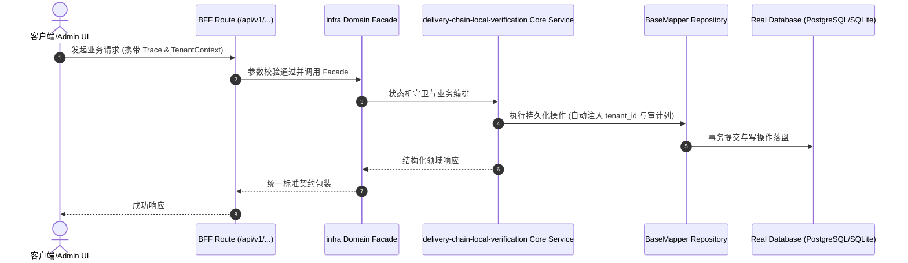

# Technical Architecture & Implementation Plan: 交付链三件套用嵌入式真实 Postgres（embedded-postgres）本地验证

> **Spec-Kit 架构与技术实施方案 (ADD: Architecture & Design Document)**
> 上游真源：`spec.md` (或 `requirements.md`)。技术方案严格支撑需求，严禁反向变更业务目标。
> 状态：`PLAN_APPROVED` | 所属领域：`infra` | 规格标识：`delivery-chain-local-verification`
> 对应项目宪法：`.specify/memory/constitution.md` (Rule 0.2 模式复用 / Rule 0.6 真实测试驱动)

---

## 1. 关键不变量与防御性约束 (Key Invariants & Guards)

1. **引擎语义不可降级** —— 只允许真实 Postgres 或 PGlite（Postgres 的 WASM 编译）；禁止退回 SQLite/内存模式并报绿
2. **无残留** —— PGlite 进程与临时目录在 finally 中清理，轮询验证端口释放

## 2. 领域架构边界与调用拓扑 (Architecture Topology & Flows)

使用 `embedded-postgres@18.4.0-beta.17`（Node，封装 zonky 的 Postgres 二进制）：`new EmbeddedPostgres({ databaseDir: <临时目录>, port: <探测到的空闲端口>, user, password, persistent: false })` → `initialise()` → `start()` → `createDatabase()` → `DATABASE_URL=postgresql://<user>:<password>@127.0.0.1:<port>/<db>` → 跑迁移/种子/起应用 → `stop()`（`persistent:false` 会连带删除 dataDir）。端点解析优先级：① 显式 `DATABASE_URL`（CI/已有库）→ 直接用；② 否则起嵌入式 Postgres；③ 起不来 → fail-loud。
**参考实现（本地 fork paperclipai/paperclip → workspace/xaicd/coolie）已精读**，采用其经验：
  · 端口冲突：先探测空闲端口，**并以 postmaster.pid 中的实际端口为准**（配置端口可能与实际不同）；
  · 集群复用：以 `<dataDir>/PG_VERSION` 存在判定已初始化，跳过 `initialise()`；残留 `postmaster.pid` 要先删；
  · `initdbFlags` 固定 `--encoding=UTF8`；locale 交给库的 `getBestLocale()`（见下方风险）；
  · 失败时必须带最近 Postgres 日志输出，否则只看到 exit code 无从排查。
**paperclip 维护的 patch 在新版已不需要**：它补的两点（locale 写死、子进程 env 丢 PATH）在最新源码里分别是 `getBestLocale()` 与 `{ ...process.env, LC_MESSAGES }`。T1 spike 必须核实安装后的 dist 确实包含这两处，否则回退 pin 18.1 + 移植其 patch。

### 核心业务时序图 (Archify Mermaid Flow)

## 3. 数据模型与持久化契约 (Data Model & Tables)

实体结构严格遵循底座 8 大审计底座字段规范：
- `id` (主键)
- `tenant_id` (多租户标识)
- `creator` / `create_time` (创建人/时间)
- `updater` / `update_time` (更新人/时间)
- `deleted` (逻辑删除标识)
- `version` (乐观锁版本号)

### 涉及实体与变更说明

## 4. API 契约与权限体系 (API Contracts & Security)

- **HTTP 路由**: `POST /api/v1/admin/infra/delivery-chain-local-verification`
- **权限标识**: `infra:delivery-chain-local-verification:query`, `infra:delivery-chain-local-verification:manage`

## 5. 状态机流转与边界守卫 (State Machine Transitions)

## 6. 技术风险评估与缓解策略 (Technical Risks & Mitigations)

- **风险**: beta 版本（18.4.0-beta.17）不稳定 -> **缓释策略**: 精确锁版本；T1 必须先做 spike 证明 initialise/start/迁移可用，失败则回退 PGlite 并说明
- **风险**: pnpm 未批准 build scripts → 二进制缺符号链接，服务起不来 -> **缓释策略**: 在 pnpm-workspace.yaml 的 allowBuilds 登记；启动失败时给出明确指引
- **风险**: 二进制体积与平台差异 -> **缓释策略**: 仅装当前平台的包；CI 若已有 PG 走 DATABASE_URL 直连，不下载
- **风险**: 误把本机压测数字当容量 -> **缓释策略**: load:test 输出显式标注『本机 ≠ 容量』，阈值仅作回归护栏
- **风险**: 改动波及检查逻辑 -> **缓释策略**: 只替换端点获取与进程生命周期；断言/清单逐字不动，用改前改后输出对照
- **风险**: `start()` 以 stderr 中出现英文就绪串判定启动完成，locale 不对会挂起 -> **缓释策略**: 依赖库的 getBestLocale()；spike 时确认该函数在 dist 中；必要时显式传 --lc-messages=C 并在失败时带日志
- **风险**: 旧版本需要维护 patch（locale/env），增加长期维护成本 -> **缓释策略**: 用最新 18.4.0-beta.17 并 spike 核实无需 patch；若仍需 patch，则按 coolie 的方式登记 patchedDependencies 并写明原因
