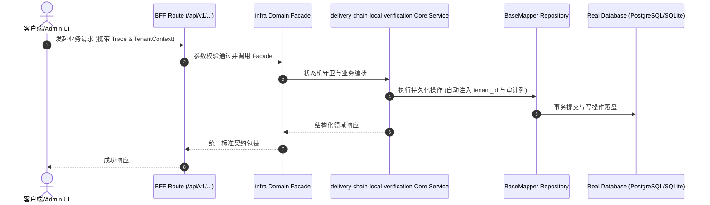

# Technical Architecture & Implementation Plan: 交付链三件套用嵌入式 Postgres（PGlite）本地验证，去除容器依赖

> **Spec-Kit 架构与技术实施方案 (ADD: Architecture & Design Document)**
> 上游真源：`spec.md` (或 `requirements.md`)。技术方案严格支撑需求，严禁反向变更业务目标。
> 状态：`PLAN_APPROVED` | 所属领域：`infra` | 规格标识：`delivery-chain-local-verification`
> 对应项目宪法：`.specify/memory/constitution.md` (Rule 0.2 模式复用 / Rule 0.6 真实测试驱动)

---

## 1. 关键不变量与防御性约束 (Key Invariants & Guards)

1. **引擎语义不可降级** —— 只允许真实 Postgres 或 PGlite（Postgres 的 WASM 编译）；禁止退回 SQLite/内存模式并报绿
2. **无残留** —— PGlite 进程与临时目录在 finally 中清理，轮询验证端口释放

## 2. 领域架构边界与调用拓扑 (Architecture Topology & Flows)

PGlite（`@electric-sql/pglite`）+ `@electric-sql/pglite-socket` 把嵌入式 Postgres 暴露为**标准 Postgres wire 协议**的 TCP 服务：`pglite-server --db=memory:// --port=<空闲端口> --host=127.0.0.1`。脚本据此构造 `DATABASE_URL=postgresql://postgres@127.0.0.1:<端口>/postgres?sslmode=disable`（`sslmode=disable` 是必需的：不带时 Prisma 报 P1001 连不上）。端点解析优先级：① 显式 `DATABASE_URL`（CI/已有库）→ 直接用；② 无 docker 依赖要求 → 起 PGlite；③ 起不来 → fail-loud。冒烟与渗透共用 `scripts/lib/ephemeral-pg.cjs`，进程与数据在 finally 中清理并轮询确认端口释放。

### 核心业务时序图 (Archify Mermaid Flow)

## 3. 数据模型与持久化契约 (Data Model & Tables)

实体结构严格遵循底座 8 大审计底座字段规范：
- `id` (主键)
- `tenant_id` (多租户标识)
- `creator` / `create_time` (创建人/时间)
- `updater` / `update_time` (更新人/时间)
- `deleted` (逻辑删除标识)
- `version` (乐观锁版本号)

### 涉及实体与变更说明

## 4. API 契约与权限体系 (API Contracts & Security)

- **HTTP 路由**: `POST /api/v1/admin/infra/delivery-chain-local-verification`
- **权限标识**: `infra:delivery-chain-local-verification:query`, `infra:delivery-chain-local-verification:manage`

## 5. 状态机流转与边界守卫 (State Machine Transitions)

## 6. 技术风险评估与缓解策略 (Technical Risks & Mitigations)

- **风险**: PGlite 与真实 Postgres 的差异导致某些迁移或查询行为不一致 -> **缓释策略**: 已实测全部迁移可在 PGlite 上应用；发现不兼容时 fail-loud，并在文档标出仅限 CI 的项
- **风险**: 把 PGlite 用于压测，得出误导性容量数字 -> **缓释策略**: 明确列为 nonGoal：load:test 继续要求真实 Postgres，并在脚本文档里写明原因
- **风险**: 改动波及检查逻辑（此前批量改动伤及单域的先例） -> **缓释策略**: 只替换「数据库端点获取 + 进程生命周期」；登录断言/12 项清单/阴性对照逐字不动，并用改前改后输出对照
- **风险**: 新增依赖影响供应链门禁 -> **缓释策略**: `@electric-sql/pglite` 与 `pglite-socket` 当前已在锁文件中（Prisma 的传递依赖，0.4.3/0.1.3）；提升为直接 devDependency，跑 `deps:audit` 复核
