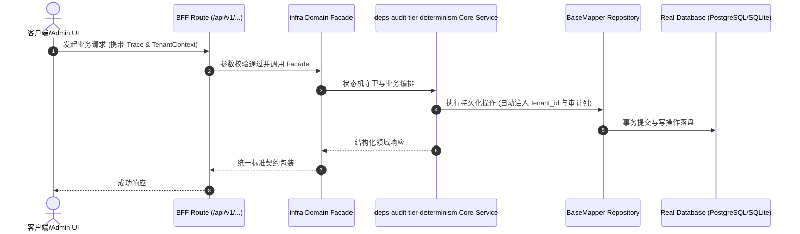

# Technical Architecture & Implementation Plan: 依赖 CVE 门禁分层判据改为从 pnpm-lock.yaml 离线推导（消除多父级包导致的 5/5/6 不确定）

> **Spec-Kit 架构与技术实施方案 (ADD: Architecture & Design Document)**
> 上游真源：`spec.md` (或 `requirements.md`)。技术方案严格支撑需求，严禁反向变更业务目标。
> 状态：`PLAN_APPROVED` | 所属领域：`infra` | 规格标识：`deps-audit-tier-determinism`
> 对应项目宪法：`.specify/memory/constitution.md` (Rule 0.2 模式复用 / Rule 0.6 真实测试驱动)

---

## 1. 关键不变量与防御性约束 (Key Invariants & Guards)

1. **分层确定性** —— 分层只由锁文件内容决定，不读任何采样字段；同一锁文件多次运行结果逐条相同（由回归测试断言）
2. **解析失败不静默** —— host 可达集合为空（或锁文件不可读）时直接报错退出，绝不返回一个全部 client-toolchain 的看似正常结果

## 2. 领域架构边界与调用拓扑 (Architecture Topology & Flows)

在 `scripts/check-deps-audit.cjs` 内新增一个**专职最小解析器**：① 按 `^---$` 切分多文档 YAML，取最后一份（第一份是 pnpm 自身的 packageManagerDependencies 段）；② 解析 `importers:`（项目键缩进 2、dep 段缩进 4、包名缩进 6）取每个 host 项目（`.` 与 `packages/**`）声明的依赖名；③ 解析 `snapshots:`（快照键缩进 2、dep 段缩进 4、`name: version` 缩进 6）建立**包名 → 依赖包名**的边（同名多版本取并集，属保守近似）；④ 从 host 项目声明名做 BFS 得到 host 可达包名集合；⑤ `tierOf()` 改为纯查表：包名在集合内 = runtime，否则 client-toolchain。解析器只认这三个缩进层，遇到无法识别的行即忽略（不猜）；解析结果为空则 fail-loud，避免退化成"全部 client-toolchain"这种看起来正常的错误答案。

### 核心业务时序图 (Archify Mermaid Flow)

## 3. 数据模型与持久化契约 (Data Model & Tables)

实体结构严格遵循底座 8 大审计底座字段规范：
- `id` (主键)
- `tenant_id` (多租户标识)
- `creator` / `create_time` (创建人/时间)
- `updater` / `update_time` (更新人/时间)
- `deleted` (逻辑删除标识)
- `version` (乐观锁版本号)

### 涉及实体与变更说明
- **-**: 不涉及数据库表；真源为 pnpm-lock.yaml，产物为 docs/architecture/artifacts/deps-audit-baseline.json

## 4. API 契约与权限体系 (API Contracts & Security)

- **HTTP 路由**: `POST /api/v1/admin/infra/deps-audit-tier-determinism`
- **权限标识**: `infra:deps-audit-tier-determinism:query`, `infra:deps-audit-tier-determinism:manage`

## 5. 状态机流转与边界守卫 (State Machine Transitions)

- 加载中：不涉及。
- 空数据：锁文件解析不到 host 可达集合时 fail-loud，不静默降级。
- 出错：锁文件缺失/不可读时明确报错。
- 成功：分层计数确定可复现，且与锚点断言一致。

## 6. 技术风险评估与缓解策略 (Technical Risks & Mitigations)

- **风险**: 手写解析器误解析锁文件，得到错误的层（且因不再崩溃而更难发现） -> **缓释策略**: 用已知答案做锚点断言（braces/mysql2/vitest 对 tar/@xmldom/xmldom/shell-quote），并在解析结果异常时 fail-loud；不追求解析全部 YAML 语法，只认三个缩进层
- **风险**: pnpm 未来调整锁文件格式导致解析静默失效 -> **缓释策略**: 解析结果为空即 fail-loud；锚点断言会在格式变化时立刻变红，而不是安静地给错答案
