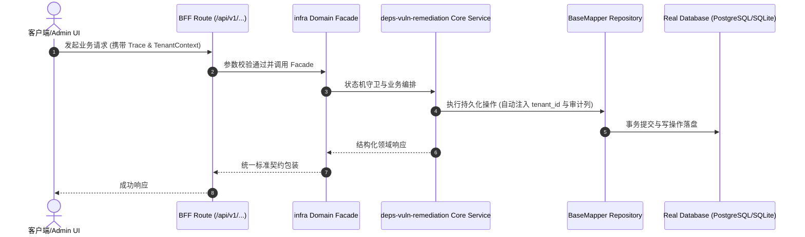

# Technical Architecture & Implementation Plan: 依赖漏洞治理：生产树止血 + 依赖 CVE 门禁 + dev 树欠债冻结

> **Spec-Kit 架构与技术实施方案 (ADD: Architecture & Design Document)**
> 上游真源：`spec.md` (或 `requirements.md`)。技术方案严格支撑需求，严禁反向变更业务目标。
> 状态：`PLAN_APPROVED` | 所属领域：`infra` | 规格标识：`deps-vuln-remediation`
> 对应项目宪法：`.specify/memory/constitution.md` (Rule 0.2 模式复用 / Rule 0.6 真实测试驱动)

---

## 1. 关键不变量与防御性约束 (Key Invariants & Guards)

1. **生产树零漏洞** —— deps:audit --prod 以 enforce 模式断言生产 importer 层漏洞数为 0，违规直接 exit!=0
2. **门禁必须证明会 fire** —— 配正向（当前状态通过）与反向（人为注入一条新增漏洞后必须被拦）双向测试；反向测试按既有惯例在跑完后恢复现场

## 2. 领域架构边界与调用拓扑 (Architecture Topology & Flows)

新增 `scripts/check-deps-audit.cjs`：薄封装 `pnpm audit --json`，按依赖根把通告分层（生产 importer=`.` 与 packages/**，dev/构建=clients/expo 的 @expo/cli 与 vitest/react-devtools-core 链），输出 { prod: [...], dev: [...] } 两类计数；`--prod` 时断言生产层为 0（enforce，违规即失败），全树模式与 `docs/architecture/artifacts/deps-audit-baseline.json` 逐条比对（ratchet，只拦新增，`--write-baseline` 显式刷新）。接线：`npm run deps:audit` 注入 `npm run check` 门禁链，并由 `scripts/write-harness-trace.cjs` 写入轨迹；证据产物沿用既有 shape（自管环境 → 产出 JSON 落 docs/architecture/artifacts/）。不引入新依赖，与 `security-scan.cjs`（运行时 12 项）职责分离：一个测「能不能被打」，一个测「带的组件有没有已知洞」。

### 核心业务时序图 (Archify Mermaid Flow)

## 3. 数据模型与持久化契约 (Data Model & Tables)

实体结构严格遵循底座 8 大审计底座字段规范：
- `id` (主键)
- `tenant_id` (多租户标识)
- `creator` / `create_time` (创建人/时间)
- `updater` / `update_time` (更新人/时间)
- `deleted` (逻辑删除标识)
- `version` (乐观锁版本号)

### 涉及实体与变更说明
- **-**: 不涉及数据库表；真源为根 package.json 与 pnpm-lock.yaml，基线为 docs/architecture/artifacts/deps-audit-baseline.json

## 4. API 契约与权限体系 (API Contracts & Security)

- **HTTP 路由**: `POST /api/v1/admin/infra/deps-vuln-remediation`
- **权限标识**: `infra:deps-vuln-remediation:query`, `infra:deps-vuln-remediation:manage`

## 5. 状态机流转与边界守卫 (State Machine Transitions)

- 加载中：不涉及。
- 空数据：无漏洞时输出 0 并 exit 0。
- 出错：pnpm audit 不可用/无网络时明确报错，不得静默当作 0 漏洞通过。
- 成功：输出生产/dev 分层计数与基线比对结果。

## 6. 技术风险评估与缓解策略 (Technical Risks & Mitigations)

- **风险**: 升级 next/mysql2 引入行为变更或构建失败（next 处于 16.x 且本仓依赖其 breaking 变更后的 API） -> **缓释策略**: 在干净已提交基线上分步升级，每步跑全量 check + 测试；失败即回滚该步，不带病提交
- **风险**: 把 dev 树的 45 条直接 enforce 会导致门禁长期红，进而被绕过 -> **缓释策略**: dev 树用 ratchet 冻结既有欠债、只拦新增；生产树才 enforce 0
- **风险**: 依赖 audit 输出随上游通告库变化而波动，造成假失败 -> **缓释策略**: 基线显式提交并可通过 `deps:audit:baseline` 刷新；刷新动作必须人工确认并在提交信息中说明
