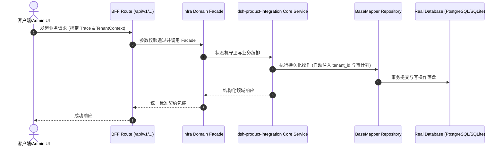

# Technical Architecture & Implementation Plan: 产物并存两种界面：业务管理 UI + dsh 对话 UI（通过 MCP 打通）

> **Spec-Kit 架构与技术实施方案 (ADD: Architecture & Design Document)**
> 上游真源：`spec.md` (或 `requirements.md`)。技术方案严格支撑需求，严禁反向变更业务目标。
> 状态：`PLAN_APPROVED` | 所属领域：`infra` | 规格标识：`dsh-product-integration`
> 对应项目宪法：`.specify/memory/constitution.md` (Rule 0.2 模式复用 / Rule 0.6 真实测试驱动)

---

## 1. 关键不变量与防御性约束 (Key Invariants & Guards)

1. **模板不含运行时** —— agent-profile.kind 仍为 workspace-bundle；反向对照：模板 import Cordis 必须红。
2. **AI 可关** —— 关闭 dsh 进程后业务界面与 API 仍然 200；用既有 delivery:boundary:check + 一条冒烟守。
3. **能力单一真源** —— dsh 的业务能力全部来自 MCP server，不在 dsh 侧重复实现业务逻辑。

## 2. 领域架构边界与调用拓扑 (Architecture Topology & Flows)

两种界面并存：Next 应用（业务 UI + /api/v1 路由）与 dsh 实例（其自带 Web UI）各自跑进程；dsh 作为 MCP client 指向 scripts/mcp/cooliebase-mcp-server.cjs（stdio），从而调用业务能力。两者共享同一数据库。模板侧只增加「声明 + 装配脚本 + 验收」，不实现运行时。

### 核心业务时序图 (Archify Mermaid Flow)

## 3. 数据模型与持久化契约 (Data Model & Tables)

实体结构严格遵循底座 8 大审计底座字段规范：
- `id` (主键)
- `tenant_id` (多租户标识)
- `creator` / `create_time` (创建人/时间)
- `updater` / `update_time` (更新人/时间)
- `deleted` (逻辑删除标识)
- `version` (乐观锁版本号)

### 涉及实体与变更说明
- **-**: 无新表；两种界面共用现有库

## 4. API 契约与权限体系 (API Contracts & Security)

- **HTTP 路由**: `POST /api/v1/admin/infra/dsh-product-integration`
- **权限标识**: `infra:dsh-product-integration:query`, `infra:dsh-product-integration:manage`

## 5. 状态机流转与边界守卫 (State Machine Transitions)

- 沿用现有状态；dsh 未启动时对话入口显示「未启用」而不是报错

## 6. 技术风险评估与缓解策略 (Technical Risks & Mitigations)

- **风险**: dsh 是 developer preview，接口会 breaking -> **缓释策略**: 只依赖 MCP 协议（稳定）与它的 CLI 启动方式；不 import 它的内部模块
- **风险**: 两套界面让客户困惑 -> **缓释策略**: 导航上明确分区；对话作为「助手」入口，不替代业务菜单
- **风险**: doNotVendor 被误读为「全面放开」 -> **缓释策略**: 改成**作用域**：template 禁 / product 需显式声明；并对模板侧保留反向对照
