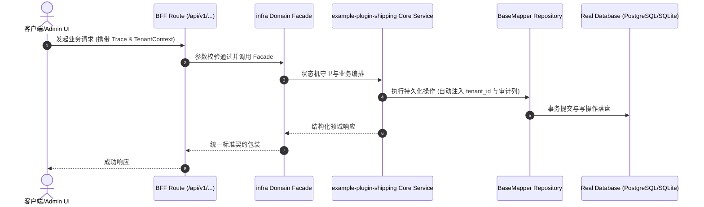

# Technical Architecture & Implementation Plan: 派生工程是否应携带示例插件 hello-world

> **Spec-Kit 架构与技术实施方案 (ADD: Architecture & Design Document)**
> 上游真源：`spec.md` (或 `requirements.md`)。技术方案严格支撑需求，严禁反向变更业务目标。
> 状态：`PLAN_APPROVED` | 所属领域：`infra` | 规格标识：`example-plugin-shipping`
> 对应项目宪法：`.specify/memory/constitution.md` (Rule 0.2 模式复用 / Rule 0.6 真实测试驱动)

---

## 1. 关键不变量与防御性约束 (Key Invariants & Guards)

1. **基座测试不因裁剪而失守** —— 基座仓内 hello-world 仍在，runtime-manager 与 plugin-sources 两组测试继续覆盖它；由 pnpm run test:unit 验证。
2. **产物无悬空引用** —— 裁剪后对产物运行 pnpm harness check 与 pnpm run test:unit；任何引用被裁文件的地方都会直接失败。

## 2. 领域架构边界与调用拓扑 (Architecture Topology & Flows)

两条链都要考虑：一是克隆链 scripts/clone-project-base.cjs（pnpm harness project create）；二是原地初始化 scripts/project-init.cjs（pnpm harness project init，也是 --in-place 的实现）。当前二者都整目录拷贝，示例插件随之进入产物。若决定裁剪，需同时处置三处引用面：packages/shared/backend/plugins/package-scanner.ts 的注释、scripts 下的扫描与契约生成、以及两个测试文件对 EXAMPLE_DIR 的依赖（测试要么随示例一起裁，要么改成自带夹具）。

### 核心业务时序图 (Archify Mermaid Flow)

## 3. 数据模型与持久化契约 (Data Model & Tables)

实体结构严格遵循底座 8 大审计底座字段规范：
- `id` (主键)
- `tenant_id` (多租户标识)
- `creator` / `create_time` (创建人/时间)
- `updater` / `update_time` (更新人/时间)
- `deleted` (逻辑删除标识)
- `version` (乐观锁版本号)

### 涉及实体与变更说明
- **-**: 本规格不新增或修改任何表。

## 4. API 契约与权限体系 (API Contracts & Security)

- **HTTP 路由**: `POST /api/v1/admin/infra/example-plugin-shipping`
- **权限标识**: `infra:example-plugin-shipping:query`, `infra:example-plugin-shipping:manage`

## 5. 状态机流转与边界守卫 (State Machine Transitions)

## 6. 技术风险评估与缓解策略 (Technical Risks & Mitigations)

- **风险**: 把 hello-world 从产物裁掉，会连带打断产物里引用它的测试，反而让产物从第一天就是红的。 -> **缓释策略**: 先实测完整引用面（T1），再决定是连测试一起裁、还是把夹具内联成测试自带的小目录；两条路都必须以产物 test:unit 全绿收尾。
- **风险**: 示例插件是插件作者唯一的可跑参考，贸然从基座也删掉，会让插件文档失去落点。 -> **缓释策略**: 本规格只讨论产物是否携带，不讨论基座是否保留；基座保留是默认。
- **风险**: 排除清单若写死在克隆脚本里，会随目录演进悄悄失效（新加的示例自动进产物而没人发现）。 -> **缓释策略**: 用一条机检断言「产物里 examples 的存在性与设计结论一致」来守，而不是靠人记住清单。
