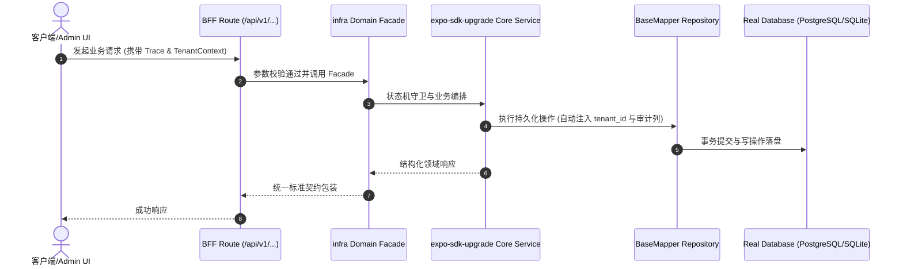

# Technical Architecture & Implementation Plan: Expo 客户端 SDK 逐级升级（52→54→55→56→57→58）以消除构建工具链 CVE

> **Spec-Kit 架构与技术实施方案 (ADD: Architecture & Design Document)**
> 上游真源：`spec.md` (或 `requirements.md`)。技术方案严格支撑需求，严禁反向变更业务目标。
> 状态：`PLAN_APPROVED` | 所属领域：`infra` | 规格标识：`expo-sdk-upgrade`
> 对应项目宪法：`.specify/memory/constitution.md` (Rule 0.2 模式复用 / Rule 0.6 真实测试驱动)

---

## 1. 关键不变量与防御性约束 (Key Invariants & Guards)

1. **每级可回滚** —— 每级只改 package.json 与锁文件，提交前必须具备全绿证据；失败直接 git checkout 回退，不保留中间态
2. **可验证性优先** —— 每级都必须通过客户端构建门禁 —— 该门禁正是本升级的前置条件，缺它不做升级

## 2. 领域架构边界与调用拓扑 (Architecture Topology & Flows)

每级操作：① 调整 `clients/expo/package.json` 中 expo 与 expo-* 子包、react-native、react 到该 SDK 要求版本（优先用 Expo 自身的版本对齐能力，避免手抄版本号）；② `pnpm install` 更新锁文件；③ 跑 `clients:build:check`（web 导出，验证客户端仍可打包）；④ 跑 `npm run check` 与全量测试；⑤ `deps:audit --audit` 记录漏洞消减，复核后刷新基线；⑥ 全绿则一次原子提交，否则 `git checkout` 回滚该级。

### 核心业务时序图 (Archify Mermaid Flow)

## 3. 数据模型与持久化契约 (Data Model & Tables)

实体结构严格遵循底座 8 大审计底座字段规范：
- `id` (主键)
- `tenant_id` (多租户标识)
- `creator` / `create_time` (创建人/时间)
- `updater` / `update_time` (更新人/时间)
- `deleted` (逻辑删除标识)
- `version` (乐观锁版本号)

### 涉及实体与变更说明
- **-**: 不涉及数据库表；真源为 clients/expo/package.json 与 pnpm-lock.yaml

## 4. API 契约与权限体系 (API Contracts & Security)

- **HTTP 路由**: `POST /api/v1/admin/infra/expo-sdk-upgrade`
- **权限标识**: `infra:expo-sdk-upgrade:query`, `infra:expo-sdk-upgrade:manage`

## 5. 状态机流转与边界守卫 (State Machine Transitions)

- 加载中：不涉及。
- 空数据：不涉及。
- 出错：回滚该级并记录原因。
- 成功：该级全绿并提交。

## 6. 技术风险评估与缓解策略 (Technical Risks & Mitigations)

- **风险**: 某级升级引入客户端破坏性 API 变更，构建或运行失败 -> **缓释策略**: 每级单独提交 + 构建门禁 + 失败即回滚；不跳过级次
- **风险**: expo export 在 CI（linux）表现与本机不同 -> **缓释策略**: 构建门禁只断言退出码与产物存在，不断言字节；失败时打印日志尾部
- **风险**: 升级后漏洞未如间接证据预期般下降 -> **缓释策略**: 以实测为准，若未下降则如实记录并更新台账，不粉饰
