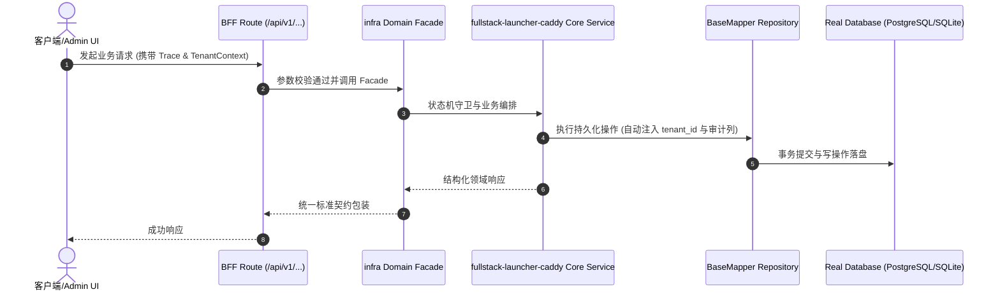

# Technical Architecture & Implementation Plan: 全栈拉起器与 Caddy 网关部署片段

> **Spec-Kit 架构与技术实施方案 (ADD: Architecture & Design Document)**
> 上游真源：`spec.md` (或 `requirements.md`)。技术方案严格支撑需求，严禁反向变更业务目标。
> 状态：`PLAN_APPROVED` | 所属领域：`infra` | 规格标识：`fullstack-launcher-caddy`
> 对应项目宪法：`.specify/memory/constitution.md` (Rule 0.2 模式复用 / Rule 0.6 真实测试驱动)

---

## 1. 关键不变量与防御性约束 (Key Invariants & Guards)

1. **拉起器与网关指向同一端口** —— 端口回退读 `package.json` 的 `dev` 脚本；`run-all.cjs --check` 输出必须为 3200 且与 caddy 片段一致。
2. **部署脚本不擅自改系统** —— 缺 `/etc/caddy/services.d` 或缺 caddy 时只打印指引（本机实测路径）。
3. **失败保留原配置** —— `caddy validate` 不过则 `exit 1` 且不覆盖已有片段。

## 2. 领域架构边界与调用拓扑 (Architecture Topology & Flows)

单向、无环：`scripts/run-all.cjs`（读 `package.json` / `.env` / `.env.local` 定端口 → 探测占用 → spawn 前后端 → 就绪自验）；`scripts/deploy-caddy.sh`（读 `deploy/caddy/*.caddy` → 校验 → 热重载，失败保留原配置）；`deploy/caddy/cooliebase-all.caddy`（网关片段：`/cooliebase-all-api/*` → `127.0.0.1:3200`）。端口真源：`package.json` 的 `dev` 脚本；派生工程由孵化器写入 `.env` 的 `PORT` 覆盖。

### 核心业务时序图 (Archify Mermaid Flow)

## 3. 数据模型与持久化契约 (Data Model & Tables)

实体结构严格遵循底座 8 大审计底座字段规范：
- `id` (主键)
- `tenant_id` (多租户标识)
- `creator` / `create_time` (创建人/时间)
- `updater` / `update_time` (更新人/时间)
- `deleted` (逻辑删除标识)
- `version` (乐观锁版本号)

### 涉及实体与变更说明
- **不适用**: 工具链改动，不涉及数据库表，不新增迁移。

## 4. API 契约与权限体系 (API Contracts & Security)

- **HTTP 路由**: `POST /api/v1/admin/infra/fullstack-launcher-caddy`
- **权限标识**: `infra:fullstack-launcher-caddy:query`, `infra:fullstack-launcher-caddy:manage`

## 5. 状态机流转与边界守卫 (State Machine Transitions)

- 不适用（无 UI）

## 6. 技术风险评估与缓解策略 (Technical Risks & Mitigations)

- **风险**: **来源越界**：文件由别的仓派发的员工写入，本仓无法约束其行为（本次差一点被 `git add -A` 提交进主干，靠 `plan:freshness` 拦下） -> **缓释策略**: 已向 coolie 提交缺陷报告（跨仓写入无授权边界 + 派发账停在 queued）；本仓侧的正规化即本规格
- **风险**: **端口与网关不一致**（本次验证发现的真实缺陷）：拉起器回退到 `3000 + offset`，而本仓与 caddy 片段是 3200 → 部署后网关指向空端口 -> **缓释策略**: 已修：回退改为读 `package.json` 的 `dev` 脚本端口；`--check` 实测输出 3200/3200
- **风险**: 拉起器含 yudao 血统的死分支（`apps/*`、`mvn`/`java`） -> **缓释策略**: 保留但不修补（见 nonGoals）；本仓路径走 Next.js 分支，实测 `--check` 正常
