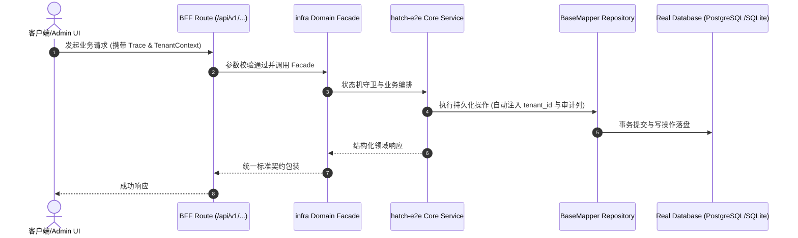

# Technical Architecture & Implementation Plan: 孵化端到端：产物自身门禁固化

> **Spec-Kit 架构与技术实施方案 (ADD: Architecture & Design Document)**
> 上游真源：`spec.md` (或 `requirements.md`)。技术方案严格支撑需求，严禁反向变更业务目标。
> 状态：`PLAN_APPROVED` | 所属领域：`infra` | 规格标识：`hatch-e2e`
> 对应项目宪法：`.specify/memory/constitution.md` (Rule 0.2 模式复用 / Rule 0.6 真实测试驱动)

---

## 1. 关键不变量与防御性约束 (Key Invariants & Guards)

1. **harness 必须能失败** —— 反向对照：注入真实缺陷（关掉 restamp）后 `--only create` 必须 exit=1 并报出「产物自身 check 失败」。
2. **基座自身不被污染** —— 所有产物写在 mkdtemp 目录，跑完 `rmSync`；`--keep` 才保留。
3. **退化为「某次验过」即失败** —— 接进 CI 独立 job（非 PR），而不是留在文档里的结论。

## 2. 领域架构边界与调用拓扑 (Architecture Topology & Flows)

方向单一，无环：
`scripts/hatch-e2e.cjs`
  → 起嵌入式 Postgres（仅 create 需要；`scripts/lib/ephemeral-pg.cjs`）
  → 入口 A `scripts/project-init.cjs --target`（SQLite，零外部依赖）
  → 入口 B `scripts/clone-project-base.cjs`（reactor：克隆 → hatch 裁剪 → 重生成 wiki → 重写规模声明 → 建库/迁移/种子）
  → 每个产物 `pnpm install --frozen-lockfile` → **产物自身的 `pnpm run check`**
  → 汇总退出码（任一非 0 即非 0）
两端都只**读**基座、只**写**临时目录；基座仓不被修改。

### 核心业务时序图 (Archify Mermaid Flow)

## 3. 数据模型与持久化契约 (Data Model & Tables)

实体结构严格遵循底座 8 大审计底座字段规范：
- `id` (主键)
- `tenant_id` (多租户标识)
- `creator` / `create_time` (创建人/时间)
- `updater` / `update_time` (更新人/时间)
- `deleted` (逻辑删除标识)
- `version` (乐观锁版本号)

### 涉及实体与变更说明
- **不适用**: 本规格是工具链改动，不涉及数据库表；不新增迁移。

## 4. API 契约与权限体系 (API Contracts & Security)

- **HTTP 路由**: `POST /api/v1/admin/infra/hatch-e2e`
- **权限标识**: `infra:hatch-e2e:query`, `infra:hatch-e2e:manage`

## 5. 状态机流转与边界守卫 (State Machine Transitions)

- 不适用（无 UI）

## 6. 技术风险评估与缓解策略 (Technical Risks & Mitigations)

- **风险**: E2E 依赖 `pnpm install` 两次（两个产物），CI 耗时上升 -> **缓释策略**: 独立 job 且仅非 PR 触发；本地可 `--only` / `--skip-install` 迭代
- **风险**: harness 通过 ≠ 产品正确（它只验「产物能跑通自己的门禁」） -> **缓释策略**: 在文档与 AGENTS 中写明它与 smoke:login / security:scan 的分工与边界，不夸大
- **风险**: 嵌入式 Postgres 在 CI 上不可用 -> **缓释策略**: smoke:login / security:scan 已在 CI 用同一条路并常年通过，风险已被既有事实覆盖
