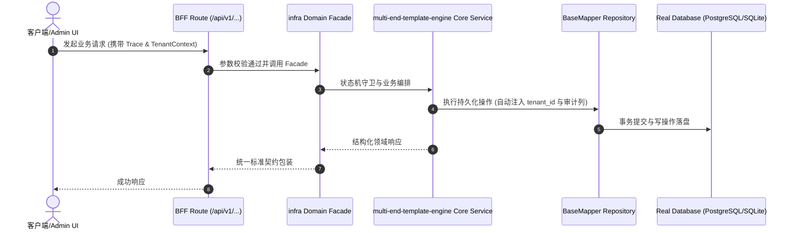

# Technical Architecture & Implementation Plan: 对标 PagePlug 与商业低代码平台：多端模版源头与响应式区块画布升级

> **Spec-Kit 架构与技术实施方案 (ADD: Architecture & Design Document)**
> 上游真源：`spec.md` (或 `requirements.md`)。技术方案严格支撑需求，严禁反向变更业务目标。
> 状态：`PLAN_APPROVED` | 所属领域：`infra` | 规格标识：`multi-end-template-engine`
> 对应项目宪法：`.specify/memory/constitution.md` (Rule 0.2 模式复用 / Rule 0.6 真实测试驱动)

---

## 1. 关键不变量与防御性约束 (Key Invariants & Guards)

1. **表达式沙箱零代码执行注入 (Zero-Eval Sandbox)** —— 表达式求值器仅解析标识符、字面量、算术/比较/逻辑/三元运算符与安全白名单方法，访问 __proto__/constructor/process/window 立即拦截并返回 undefined。
2. **存量 342 份 PageSchema 100% 向下兼容** —— blocks、queries、visibleOn 等全部声明为 optional，当未配置 blocks 时 UniversalSchemaCanvas 自动根据字段推导默认统计摘要与增强视图。
3. **前后端业务域同源裁剪一致性** —— DOMAIN_PATH_PREFIXES 包含 clients/expo/src/modules/，被排除的业务域在客户端源码中同步物理剔除，且客户端模块注册表支持优雅降级。

## 2. 领域架构边界与调用拓扑 (Architecture Topology & Flows)

契约层 (page-schema.validators.ts 定义 PageBlockDSL v2：20+ 控件 + blocks[] + queries[] + visibleOn/disabledOn 表达式) -> 引擎层 (packages/shared/frontend/lib/expression-engine.ts 提供零 eval 响应式求值) -> 渲染层 (B 端 UniversalSchemaCanvas 支持指标卡/图表/看板/表格切换与联动表单；C 端 clients/expo 按 app+shared+modules/<domain> 组织并渲染移动端区块；设计器 OnlineDefinitionDesigner 提供 PC/375px 手机双视口预览) -> 孵化层 (hatch-profile.cjs 联动裁剪后端插件与客户端 modules/<domain>)。

### 核心业务时序图 (Archify Mermaid Flow)

## 3. 数据模型与持久化契约 (Data Model & Tables)

实体结构严格遵循底座 8 大审计底座字段规范：
- `id` (主键)
- `tenant_id` (多租户标识)
- `creator` / `create_time` (创建人/时间)
- `updater` / `update_time` (更新人/时间)
- `deleted` (逻辑删除标识)
- `version` (乐观锁版本号)

### 涉及实体与变更说明
- **system_config**: 复用 key='page.schema.<entity>' 持久化存储升级后的 PageBlockDSL v2 JSON，零破坏性 DDL

## 4. API 契约与权限体系 (API Contracts & Security)

- **HTTP 路由**: `POST /api/v1/admin/infra/multi-end-template-engine`
- **权限标识**: `infra:multi-end-template-engine:query`, `infra:multi-end-template-engine:manage`

## 5. 状态机流转与边界守卫 (State Machine Transitions)

- 加载中：指标卡、图表与表格/看板区域局部脉冲骨架屏，不阻塞顶栏。
- 空数据：表格与看板列展示结构化空态与快捷新建引导，保留筛选栏。
- 出错：展示错误原因与一键重试按钮；表达式语法错误时静默降级并在设计器高亮提示。
- 无权限：受权限码与 Action 条件表达式双重守卫控制。

## 6. 技术风险评估与缓解策略 (Technical Risks & Mitigations)

- **风险**: 客户端拆分为 modules/<domain> 后，若某个业务域在 vertical 孵化时被裁掉，客户端入口静态 import 会报 Module not found -> **缓释策略**: 在 clients/expo/src/modules/index.ts 采用安全模块装配与可选发现机制，并在 hatch-profile.cjs 中同步裁剪被排除域的模块目录
- **风险**: 用户编写错误语法的 {{ 表达式 }} 导致前端页面白屏崩溃 -> **缓释策略**: expression-engine.ts 全程捕获解析异常并回退默认值 (false/undefined)，绝不向 React 渲染树抛出未捕获异常

## 7. E2E 页面拟人操作运营配置与全链路自动化测试 (E2E Human-Like Ops & Automated Testing)

- **反 Seed 铁律（Rule 0.8）**：严禁通过 SQL 脚本或后台静默函数直接灌入商品、分类、优惠券、营销活动等业务运营数据；必须通过 Playwright 驱动真实浏览器页面拟人操作（登录 `/admin/login` -> 打开 `/admin/infra/...` 运营页 -> 点击 `createButton` -> 填写 `[data-testid="field-..."]` -> 点击 `formSubmit` -> 断言 `table` 新增行）完成运营配置。
- **B 端运营配置 → C 端消费体验 → B 端履约闭环**：通过 `pnpm run e2e:ops` 与 `pnpm run test:matrix` 执行端到端拟人配置与真实数据库状态机全链路验证。
