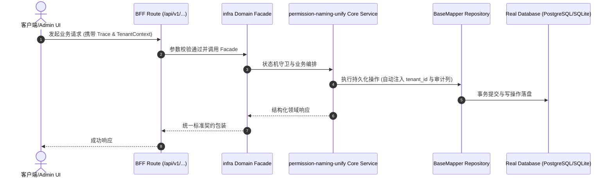

# Technical Architecture & Implementation Plan: 统一权限码命名：契约 kebab 化 + 路由静态取键 + 全量重生成

> **Spec-Kit 架构与技术实施方案 (ADD: Architecture & Design Document)**
> 上游真源：`spec.md` (或 `requirements.md`)。技术方案严格支撑需求，严禁反向变更业务目标。
> 状态：`PLAN_APPROVED` | 所属领域：`infra` | 规格标识：`permission-naming-unify`
> 对应项目宪法：`.specify/memory/constitution.md` (Rule 0.2 模式复用 / Rule 0.6 真实测试驱动)

---

## 1. 关键不变量与防御性约束 (Key Invariants & Guards)

1. **未登记即编译失败** —— 路由静态取键 PERMISSIONS.X；X 不存在 → TS2339。反向对照：删一个键必须让构建红。
2. **三种命名收敛为一** —— 契约 permissionPrefix、路由键、菜单种子三者的映射关系写在 brief 与测试里，且 contracts:governance 覆盖检查能发现不一致。
3. **对外契约不变** —— API path、DTO、错误码不动；用 agent:routes:check + build + 契约测试守。

## 2. 领域架构边界与调用拓扑 (Architecture Topology & Flows)

契约生成：scripts/import-source-tables.ts 里 permissionPrefix 由 domain:snake(className) 改为 domain:kebab。路由模板：codegen-templates/route.template.ts 从 PERMISSIONS[动态键] 兜底字面量 改为静态键 PERMISSIONS.<DOMAIN>_<KEBAB>_<ACTION>。权限表：packages/shared/backend/constants/permissions.ts 的生成段按新键重写。数据流：契约 → 路由模板 → 路由文件；三者必须同一次变更内对齐，否则中途编译不过。

### 核心业务时序图 (Archify Mermaid Flow)

## 3. 数据模型与持久化契约 (Data Model & Tables)

实体结构严格遵循底座 8 大审计底座字段规范：
- `id` (主键)
- `tenant_id` (多租户标识)
- `creator` / `create_time` (创建人/时间)
- `updater` / `update_time` (更新人/时间)
- `deleted` (逻辑删除标识)
- `version` (乐观锁版本号)

### 涉及实体与变更说明
- **-**: 无表；涉及契约 JSON、路由 TS、权限常量三处生成物

## 4. API 契约与权限体系 (API Contracts & Security)

- **HTTP 路由**: `POST /api/v1/admin/infra/permission-naming-unify`
- **权限标识**: `infra:permission-naming-unify:query`, `infra:permission-naming-unify:manage`

## 5. 状态机流转与边界守卫 (State Machine Transitions)

- 无 UI，故不涉及

## 6. 技术风险评估与缓解策略 (Technical Risks & Mitigations)

- **风险**: 340 个路由文件同时变更，review 困难 -> **缓释策略**: 分两批：先契约 + 权限表（无行为变更），再路由重生成；每批独立可构建
- **风险**: 菜单种子里的历史权限码与新键不匹配，导致线上授权失效 -> **缓释策略**: 值不换（仍是 domain:kebab:query），只换键名与取法；迁移时不动已有数据
- **风险**: 部分域的表没有元数据，kebab 推导可能不一致 -> **缓释策略**: 用 domain-catalog + 契约里已有的 kebab 字段作为唯一来源，不从 className 反推
