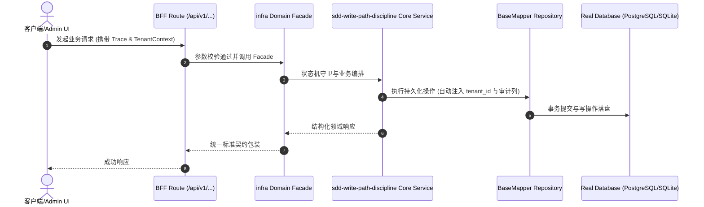

# Technical Architecture & Implementation Plan: 吸收 SDD 四重铁律：写链路闭环 / 统一请求契约 / 红绿对抗 E2E / 无深度测试不发布

> **Spec-Kit 架构与技术实施方案 (ADD: Architecture & Design Document)**
> 上游真源：`spec.md` (或 `requirements.md`)。技术方案严格支撑需求，严禁反向变更业务目标。
> 状态：`PLAN_APPROVED` | 所属领域：`infra` | 规格标识：`sdd-write-path-discipline`
> 对应项目宪法：`.specify/memory/constitution.md` (Rule 0.2 模式复用 / Rule 0.6 真实测试驱动)

---

## 1. 关键不变量与防御性约束 (Key Invariants & Guards)

1. **存量不被误伤** —— 所有新门禁都是 ratchet：基线逐条列出存量，新增才红；由「修复前全量跑一遍，红线只在新增项」守。
2. **不伪造覆盖** —— E2E 深度只做度量与报告，不声称覆盖率达标；由文档与 report-only 输出守。

## 2. 领域架构边界与调用拓扑 (Architecture Topology & Flows)

**四条铁律在本仓的改写对照**（外部项目 → 本仓）：
1. 『动页面必闭环写链路』→ **保留**：规格触及含表单页面时，brief 必须把写事务旅程列为验收条款（校验规则 → 落库位置 → 可验证证据）。本仓对应物是 `brief.acceptance` + `tasks`，可在 `speckit spec check` 里判。
2. 『AES 传输契约』→ **改写为『统一请求契约』**：本仓没有传输加密信封（`request.ts:101` 就是明文 `response.json()`），但有统一请求层 `packages/shared/frontend/lib/request.ts`（带 `code`/`messageKey`/`details`/401 跳转）。故约束改为：**页面与组件禁止裸 `fetch(`**，必须走统一层。实测 9 个文件违规。
3. 『红绿对抗双层 E2E』→ **保留为标准**，但**现状是空壳**：`test/e2e/` 只有 1 个 20 行文件、2 个用例，只断言 `status < 500`。所以本规格只交付**标准 + 模板 + 一条真实样例**，并给出**深度度量**（report-only）。
4. 『Harness 守卫拦截』→ **落地为门禁**：改了写路由/表单页但测试只有静态断言 → 阻断。因存量 955/360 规模，采用**棘轮**：冻结存量，新增必须带深度测试或显式豁免。

数据来源（都是实测）：`find src/app/api packages/*/*/routes -name route.ts` → 1105 个，其中含写方法 955；`*.page.tsx` 768 个，含表单 360；页面内裸 `fetch(` 9 个；`test/e2e/` 2 个占位用例。

### 核心业务时序图 (Archify Mermaid Flow)

## 3. 数据模型与持久化契约 (Data Model & Tables)

实体结构严格遵循底座 8 大审计底座字段规范：
- `id` (主键)
- `tenant_id` (多租户标识)
- `creator` / `create_time` (创建人/时间)
- `updater` / `update_time` (更新人/时间)
- `deleted` (逻辑删除标识)
- `version` (乐观锁版本号)

### 涉及实体与变更说明
- **-**: 本规格不新增或修改任何表。

## 4. API 契约与权限体系 (API Contracts & Security)

- **HTTP 路由**: `POST /api/v1/admin/infra/sdd-write-path-discipline`
- **权限标识**: `infra:sdd-write-path-discipline:query`, `infra:sdd-write-path-discipline:manage`

## 5. 状态机流转与边界守卫 (State Machine Transitions)

## 6. 技术风险评估与缓解策略 (Technical Risks & Mitigations)

- **风险**: 把外部项目的 AES 契约照搬，会要求本仓实现不存在的传输加密，导致所有前端调用被判违规（假阳性）。 -> **缓释策略**: 本规格明确改写为『统一请求层』，并在文档里记录『本仓无传输信封』这一事实。
- **风险**: 第 4 条一刀切：955 个写路由、360 个表单页、E2E 近乎为零 → 立刻全仓红。 -> **缓释策略**: ratchet：基线冻结存量，只拦新增；并在规格里显式列出存量清单。
- **风险**: 为了让门禁绿，有人把『写链路』塞进注释或写成 toBeVisible 糊过去。 -> **缓释策略**: 判据要求**可执行证据**（真实 API 调用 / 落库断言），静态断言不算；并由反向对照锁住。
- **风险**: E2E 依赖本机嵌入式 Postgres，而 macOS `kern.sysv.shmseg=8` 易被其它项目泄漏实例占满（已实测）。 -> **缓释策略**: 样例 E2E 设计与文档里注明该环境前提；门禁本身不依赖跑 E2E（只做静态判定），避免把门禁绑在脆弱环境上。
