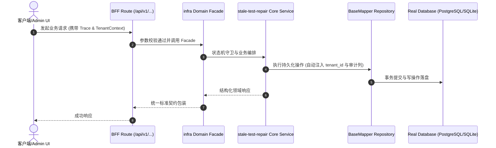

# Technical Architecture & Implementation Plan: 修复 6 条既存测试失败：退役脚本引用 + 过期断言

> **Spec-Kit 架构与技术实施方案 (ADD: Architecture & Design Document)**
> 上游真源：`spec.md` (或 `requirements.md`)。技术方案严格支撑需求，严禁反向变更业务目标。
> 状态：`PLAN_APPROVED` | 所属领域：`infra` | 规格标识：`stale-test-repair`
> 对应项目宪法：`.specify/memory/constitution.md` (Rule 0.2 模式复用 / Rule 0.6 真实测试驱动)

---

## 1. 关键不变量与防御性约束 (Key Invariants & Guards)

1. **声明的技能必须真实存在** —— agent-profile 测试遍历全部分层，逐项校验 .agents/skills/<name>/SKILL.md 存在，缺失即失败并列出具体项
2. **测试零残留** —— beforeAll/afterAll 清理活跃区与归档区；用跑前跑后 git status 一致作为客观判据

## 2. 领域架构边界与调用拓扑 (Architecture Topology & Flows)

两条修补都在测试侧：① `test/unit/spec-driven-agent-workflow.test.ts`：三处 `execFileSync` 的目标由 `scripts/spec-ops.ts` 改为 `scripts/speckit.ts`（子命令与参数不变）；第 2 条用例里对 `根因分析 (Root Cause)` 的 toContain 断言改为锚定标题的正则 /^### 根因分析 \(Root Cause/m，以容忍生成器标题后缀 - 5-Whys 且仍要求它是标题行。② `scripts/lib/__tests__/agent-profile.test.ts`：L0/L4 的 toEqual 改为 expect.arrayContaining（保住核心技能必须在），并新增一条不变量断言 —— 遍历 `profile.npc.layers` 全部分层，每个声明技能都必须能找到 `.agents/skills/<name>/SKILL.md`，否则报出缺失项。这把引用必须可落地从靠人记变成可执行检查，也顺带覆盖了本次同类失效（退役入口无人校验）。

### 核心业务时序图 (Archify Mermaid Flow)

## 3. 数据模型与持久化契约 (Data Model & Tables)

实体结构严格遵循底座 8 大审计底座字段规范：
- `id` (主键)
- `tenant_id` (多租户标识)
- `creator` / `create_time` (创建人/时间)
- `updater` / `update_time` (更新人/时间)
- `deleted` (逻辑删除标识)
- `version` (乐观锁版本号)

### 涉及实体与变更说明
- **-**: 不涉及数据库表；仅测试文件与断言调整

## 4. API 契约与权限体系 (API Contracts & Security)

- **HTTP 路由**: `POST /api/v1/admin/infra/stale-test-repair`
- **权限标识**: `infra:stale-test-repair:query`, `infra:stale-test-repair:manage`

## 5. 状态机流转与边界守卫 (State Machine Transitions)

- 加载中：不涉及。
- 空数据：不适用。
- 出错：断言失败时打印实际值，便于定位。
- 成功：两个文件全绿，全量 failed = 0。

## 6. 技术风险评估与缓解策略 (Technical Risks & Mitigations)

- **风险**: 把精确全等改成 arrayContaining 后，列表里出现拼错/已删除的技能也不再被发现 -> **缓释策略**: 新增「声明的技能必须真实存在」断言 —— 它恰好能抓到拼错与悬空引用，比原来的精确全等更强
- **风险**: speckit 与 spec-ops 的输出结构若有差异，改完仍红 -> **缓释策略**: 已实测：改脚本名后 5 条里 4 条立即转绿，仅剩 1 条标题断言；该断言已按生成器实际输出核对后再修
