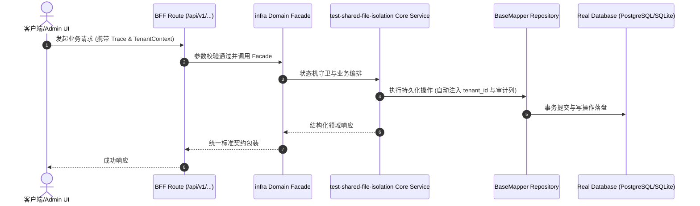

# Technical Architecture & Implementation Plan: 测试之间通过仓库共享文件互相可见，导致 test:clean 间歇随机变红

> **Spec-Kit 架构与技术实施方案 (ADD: Architecture & Design Document)**
> 上游真源：`spec.md` (或 `requirements.md`)。技术方案严格支撑需求，严禁反向变更业务目标。
> 状态：`PLAN_APPROVED` | 所属领域：`infra` | 规格标识：`test-shared-file-isolation`
> 对应项目宪法：`.specify/memory/constitution.md` (Rule 0.2 模式复用 / Rule 0.6 真实测试驱动)

---

## 1. 关键不变量与防御性约束 (Key Invariants & Guards)

1. **测试互不污染** —— 任一测试改写共享文件后，其它测试看到的必须是原状；由「连跑 3 次结果一致」与「跑完 git status 干净」共同守。
2. **门禁判定语义不变** —— 修复前后对同一份违规输入，门禁必须给出同样的结论（用一条固定 fixture 对照）。

## 2. 领域架构边界与调用拓扑 (Architecture Topology & Flows)

共享文件清单（实测）至少包含：`package.json`、`scripts/harness.cjs`、`docs/architecture/artifacts/harness-unreachable-scripts.json`、`docs/architecture/artifacts/typecheck-baseline.json`、`docs/architecture/artifacts/engineering-standards-baseline.json`。涉及的门禁脚本：`check-harness-integrity`、`check-harness-trunk-dispatch`、`check-engineering-standards`、`check-typecheck-ratchet`、`check-generated-paths`、`check-plan-freshness`、`check-version-consistency` 等。候选方向：① 门禁接受 `--root <dir>`，测试在临时根上跑（拷可变件、软链只读件）；② 门禁接受 `--package-json <path>` 之类的窄口径覆盖；③ 测试串行化到同一行（已试 `singleFork`，否掉）。

### 核心业务时序图 (Archify Mermaid Flow)

## 3. 数据模型与持久化契约 (Data Model & Tables)

实体结构严格遵循底座 8 大审计底座字段规范：
- `id` (主键)
- `tenant_id` (多租户标识)
- `creator` / `create_time` (创建人/时间)
- `updater` / `update_time` (更新人/时间)
- `deleted` (逻辑删除标识)
- `version` (乐观锁版本号)

### 涉及实体与变更说明
- **-**: 本规格不新增或修改任何表。

## 4. API 契约与权限体系 (API Contracts & Security)

- **HTTP 路由**: `POST /api/v1/admin/infra/test-shared-file-isolation`
- **权限标识**: `infra:test-shared-file-isolation:query`, `infra:test-shared-file-isolation:manage`

## 5. 状态机流转与边界守卫 (State Machine Transitions)

## 6. 技术风险评估与缓解策略 (Technical Risks & Mitigations)

- **风险**: 为了隔离改成「临时根」，但只读件用软链，某些门禁可能顺着软链读回真仓，隔离失效却看起来通过了。 -> **缓释策略**: 反向对照必须包含「在临时根里注入违规 → 必须红」，确保读到的是临时根。
- **风险**: 把共享文件改成可注入路径，等于给门禁加开关，未来有人用开关放行。 -> **缓释策略**: 候选里写明：若采用注入，开关只能影响「从哪读」，不能影响「怎么判」。
- **风险**: 「连跑 3 次」在慢机器上耗时过长，被后续开发者删掉。 -> **缓释策略**: 把 3 次拆成可单独运行的脚本入口（`pnpm harness` 下），不塞进默认 `check` 链。
