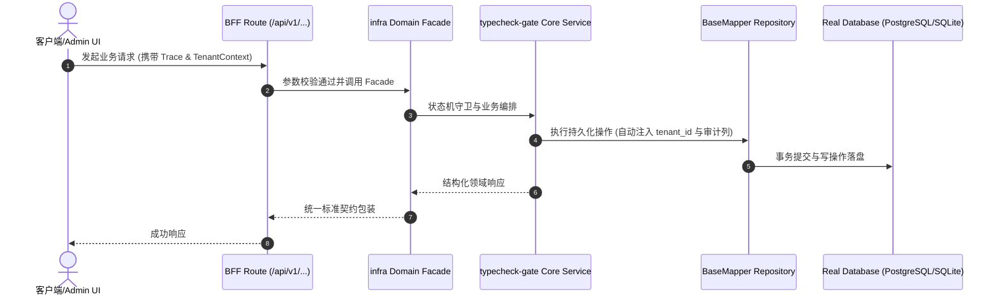

# Technical Architecture & Implementation Plan: 类型检查纳入交付门禁：1268 个存量类型错误的分级治理

> **Spec-Kit 架构与技术实施方案 (ADD: Architecture & Design Document)**
> 上游真源：`spec.md` (或 `requirements.md`)。技术方案严格支撑需求，严禁反向变更业务目标。
> 状态：`PLAN_APPROVED` | 所属领域：`infra` | 规格标识：`typecheck-gate`
> 对应项目宪法：`.specify/memory/constitution.md` (Rule 0.2 模式复用 / Rule 0.6 真实测试驱动)

---

## 1. 关键不变量与防御性约束 (Key Invariants & Guards)

1. **只拦新增** —— 当前错误集合 − 基线集合 = 新增；新增非空 → exit 1。反向对照：注入一处错误必须被拦。
2. **解析失败必须失败** —— tsc 输出解析不出任何 `error TS` 且退出码非 0 → 视为门禁故障，exit 2（不得当成「0 错误」静默通过）
3. **基线不可静默增长** —— 只有 `--write-baseline` 能改基线；CI 不自动写。基线增长会在 diff 里可见。

## 2. 领域架构边界与调用拓扑 (Architecture Topology & Flows)

scripts/check-types.cjs（已存在，跑 tsc --noEmit）→ 新增基线比对层 → 输出新增错误 → 退出码。基线落 docs/architecture/artifacts/typecheck-baseline.json。门禁脚本 scripts/check-typecheck-ratchet.cjs 读基线并与当前输出比对；`--write-baseline` 显式收紧。不跨域、无数据访问。

### 核心业务时序图 (Archify Mermaid Flow)

## 3. 数据模型与持久化契约 (Data Model & Tables)

实体结构严格遵循底座 8 大审计底座字段规范：
- `id` (主键)
- `tenant_id` (多租户标识)
- `creator` / `create_time` (创建人/时间)
- `updater` / `update_time` (更新人/时间)
- `deleted` (逻辑删除标识)
- `version` (乐观锁版本号)

### 涉及实体与变更说明
- **-**: 无表；本 spec 只涉及脚本与基线 JSON

## 4. API 契约与权限体系 (API Contracts & Security)

- **HTTP 路由**: `POST /api/v1/admin/infra/typecheck-gate`
- **权限标识**: `infra:typecheck-gate:query`, `infra:typecheck-gate:manage`

## 5. 状态机流转与边界守卫 (State Machine Transitions)

- 无 UI，故不涉及

## 6. 技术风险评估与缓解策略 (Technical Risks & Mitigations)

- **风险**: tsc 全量跑 14s，进 check 链会加长门禁 -> **缓释策略**: 实测 14s，可接受；若变慢，改为只对 `packages/**` 与 `src/**` 跑（仍覆盖业务代码）
- **风险**: 基线按「错误消息全文」比对，改一行代码可能让同一错误的消息变化 → 误判为新增 -> **缓释策略**: 基线键用 `file+line+code`（不用消息全文），并接受「行号漂移=新增」的保守语义，在文档里写明
- **风险**: 有人用 `// @ts-expect-error` 消掉错误但留下坑 -> **缓释策略**: 加一条统计：`@ts-expect-error` / `@ts-ignore` 计数也进基线（只拦新增）
