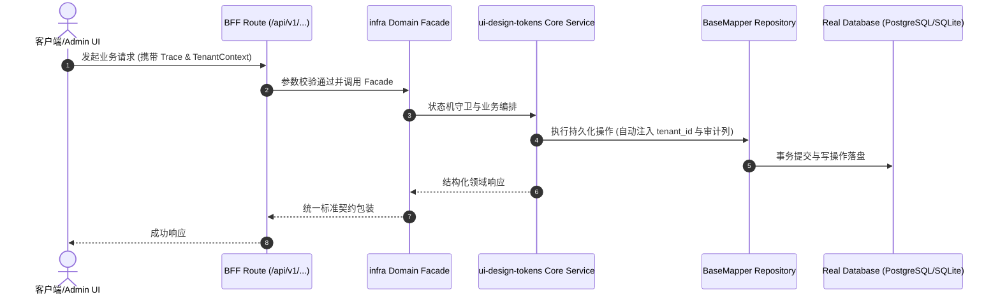

# Technical Architecture & Implementation Plan: UI 设计规范可执行化：design tokens + 裸 px/py 门禁 + 基线页与 codegen 共用

> **Spec-Kit 架构与技术实施方案 (ADD: Architecture & Design Document)**
> 上游真源：`spec.md` (或 `requirements.md`)。技术方案严格支撑需求，严禁反向变更业务目标。
> 状态：`PLAN_APPROVED` | 所属领域：`infra` | 规格标识：`ui-design-tokens`
> 对应项目宪法：`.specify/memory/constitution.md` (Rule 0.2 模式复用 / Rule 0.6 真实测试驱动)

---

## 1. 关键不变量与防御性约束 (Key Invariants & Guards)

1. **单一真源** —— 间距只来自 design-tokens.ts；模板与页面都引用，不各自硬编码。
2. **门禁必须能失败** —— 反向对照：写一个裸 px-4 到任一列表页 → check 必须红。

## 2. 领域架构边界与调用拓扑 (Architecture Topology & Flows)

packages/shared/frontend/lib/design-tokens.ts 导出 `UI` 常量（纯字符串，Tailwind class）。手写页面与 codegen 模板都 import 它。门禁 scripts/check-design-tokens.cjs 扫描 frontend/**/*.tsx，禁止在 <td>/<th> 上出现裸 px-*/py-*（棘轮，基线冻结存量）。

### 核心业务时序图 (Archify Mermaid Flow)

## 3. 数据模型与持久化契约 (Data Model & Tables)

实体结构严格遵循底座 8 大审计底座字段规范：
- `id` (主键)
- `tenant_id` (多租户标识)
- `creator` / `create_time` (创建人/时间)
- `updater` / `update_time` (更新人/时间)
- `deleted` (逻辑删除标识)
- `version` (乐观锁版本号)

### 涉及实体与变更说明
- **-**: 无表；纯前端常量与门禁

## 4. API 契约与权限体系 (API Contracts & Security)

- **HTTP 路由**: `POST /api/v1/admin/infra/ui-design-tokens`
- **权限标识**: `infra:ui-design-tokens:query`, `infra:ui-design-tokens:manage`

## 5. 状态机流转与边界守卫 (State Machine Transitions)

- 沿用现有状态（加载/空/错误/无权限）

## 6. 技术风险评估与缓解策略 (Technical Risks & Mitigations)

- **风险**: 存量 340 页面都裸写 px-*，一次性改风险大 -> **缓释策略**: 棘轮冻结存量，只拦新增；分批迁移
- **风险**: token 抽取过度导致可读性下降 -> **缓释策略**: 只抽表格/页面头/按钮/卡片四组，别把每个 class 都抽成变量
