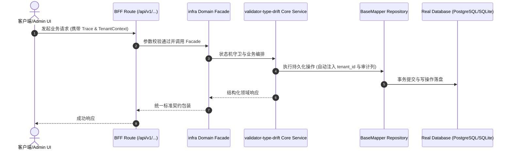

# Technical Architecture & Implementation Plan: 校验器类型漂移：检测工具已能对齐，但它不是门禁、且有识别盲区

> **Spec-Kit 架构与技术实施方案 (ADD: Architecture & Design Document)**
> 上游真源：`spec.md` (或 `requirements.md`)。技术方案严格支撑需求，严禁反向变更业务目标。
> 状态：`PLAN_APPROVED` | 所属领域：`infra` | 规格标识：`validator-type-drift`
> 对应项目宪法：`.specify/memory/constitution.md` (Rule 0.2 模式复用 / Rule 0.6 真实测试驱动)

---

## 1. 关键不变量与防御性约束 (Key Invariants & Guards)

1. **门禁只报警、不落盘** —— `--check` 分支不调用 `fs.writeFileSync`；由「跑完 git status 干净」守。
2. **既有约定不被当漂移** —— `id` / `*_id` 仍走 `convention` 计数分支；由现有 348 处跳过数不变来守。

## 2. 领域架构边界与调用拓扑 (Architecture Topology & Flows)

数据流：`scripts/data/*-tables.ts`（**表定义真源**，AGENTS §9.5）→ codegen → `packages/*/backend/validators/*.validator.ts`（生成物）。生成物会停在旧版本，故需对齐检查。
工具现结构：`loadMetadata()` 读元数据 → `domainTables()` 按**仓储文件名**把表与域关联 → 逐文件用正则匹配字段声明 → 与元数据比较 → 打印。
要加的：`--check` 分支（只统计、不写、`changed>0` 时 `process.exit(1)`）+ 扩大正则识别集合。
接线点：`package.json` 的 `check` 链 + `packages/shared/contract/compat-manifest.json` 的 `consumptionSurface.gates`（真源）→ 再 `pnpm run surface:sync` 生成镜像。

### 核心业务时序图 (Archify Mermaid Flow)

## 3. 数据模型与持久化契约 (Data Model & Tables)

实体结构严格遵循底座 8 大审计底座字段规范：
- `id` (主键)
- `tenant_id` (多租户标识)
- `creator` / `create_time` (创建人/时间)
- `updater` / `update_time` (更新人/时间)
- `deleted` (逻辑删除标识)
- `version` (乐观锁版本号)

### 涉及实体与变更说明
- **-**: 本规格不新增或修改任何表。

## 4. API 契约与权限体系 (API Contracts & Security)

- **HTTP 路由**: `POST /api/v1/admin/infra/validator-type-drift`
- **权限标识**: `infra:validator-type-drift:query`, `infra:validator-type-drift:manage`

## 5. 状态机流转与边界守卫 (State Machine Transitions)

## 6. 技术风险评估与缓解策略 (Technical Risks & Mitigations)

- **风险**: 扩大正则识别集合时误伤：把 `z.number()` 纳入后，某些**本来就该是** number 的列（元数据是 int/bigint）可能被判成漂移。 -> **缓释策略**: 判定仍是「与元数据比较」，不是「写法黑名单」；并用现有 0 需改作基线 —— 扩大识别后若突然冒出大量『需改』，说明匹配键或类型映射有误，先查再改。
- **风险**: 把 `--write` 误接进门禁，导致 check 会改代码。 -> **缓释策略**: `--check` 与 `--write` 互斥（同时给则报错退出 2），并由「跑完 git status 干净」守。
- **风险**: 门禁接进 check 后拖慢全量门禁（要读 323 份校验器 + 全部元数据）。 -> **缓释策略**: 实测该工具全仓 dry-run 约数秒级；若明显变慢，改为按域并行或只扫 `packages/plugins` 与 `packages/domains` 的 validators 目录。
