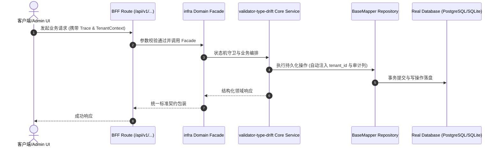

# Technical Architecture & Implementation Plan: 生成校验器字段类型与表元数据相悖导致 HTTP 边界拒绝合法输入

> **Spec-Kit 架构与技术实施方案 (ADD: Architecture & Design Document)**
> 上游真源：`spec.md` (或 `requirements.md`)。技术方案严格支撑需求，严禁反向变更业务目标。
> 状态：`PLAN_APPROVED` | 所属领域：`infra` | 规格标识：`validator-type-drift`
> 对应项目宪法：`.specify/memory/constitution.md` (Rule 0.2 模式复用 / Rule 0.6 真实测试驱动)

---

## 1. 关键不变量与防御性约束 (Key Invariants & Guards)

1. **校验器不得比元数据更严格（文本列必须接受字符串）** —— codemod 按元数据类型重写 + 门禁 `validator:types:check` 比对；ID 约定走显式白名单
2. **ID 字符串化属有意约定，不得被误改** —— codemod 与门禁都对 `id` 及元数据为数值型的 `*_id` 显式跳过，并在门禁输出中计数

## 2. 领域架构边界与调用拓扑 (Architecture Topology & Flows)

链路：`src/app/api/v1/...` 或 `packages/plugins/plugin-<域>/routes/admin/<资源>/route.ts`
→ `packages/plugins/plugin-<域>/backend/validators/<资源>.validator.ts`（Zod）
→ `backend/services/<资源>.service.ts` → `backend/repositories/<资源>.repository.ts`。

字段类型的真源是表元数据 `scripts/data/<域>-source-tables.ts` 的 `table.columns[].type` / `.tsType`，
校验器是它的**生成物**。修补方案：写一个**可复用的 codemod**
（`scripts/align-validator-types.ts --domain <域> [--write]`），
按元数据类型重写 Zod 字段构造器：数值型 → `z.coerce.number().finite()`，文本型 → `z.string().trim()`，
布尔 → `z.boolean()`，时间 → `z.string()`；`id` 类显式跳过（有意约定）。

### 核心业务时序图 (Archify Mermaid Flow)

## 3. 数据模型与持久化契约 (Data Model & Tables)

实体结构严格遵循底座 8 大审计底座字段规范：
- `id` (主键)
- `tenant_id` (多租户标识)
- `creator` / `create_time` (创建人/时间)
- `updater` / `update_time` (更新人/时间)
- `deleted` (逻辑删除标识)
- `version` (乐观锁版本号)

### 涉及实体与变更说明
- **ai_api_key**: 试点资源；`status` 物理 VARCHAR、元数据 varchar，校验器误为 number

## 4. API 契约与权限体系 (API Contracts & Security)

- **HTTP 路由**: `POST /api/v1/admin/infra/validator-type-drift`
- **权限标识**: `infra:validator-type-drift:query`, `infra:validator-type-drift:manage`

## 5. 状态机流转与边界守卫 (State Machine Transitions)

- 加载中：正常展示。
- 空数据：正常展示。
- 出错：正常展示，具备明确指引。
- 成功：正常展示。

## 6. 技术风险评估与缓解策略 (Technical Risks & Mitigations)

- **风险**: 放宽校验可能让原本被拦的非法入参通过 -> **缓释策略**: 只按**元数据类型**放宽（文本列才放宽为字符串），数值列语义不变；并以真实库域级测试 + 既有 route 契约测试作为回归网
- **风险**: 794 处一次改完难以审阅 -> **缓释策略**: 按域试点 → 验证 → 逐域推广，每域原子提交；未修域棘轮冻结
