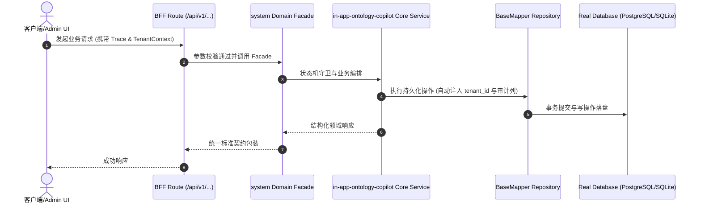

# Technical Architecture & Implementation Plan: 底座内嵌活体本体自省与AI Copilot抽屉

> **Spec-Kit 架构与技术实施方案 (ADD: Architecture & Design Document)**
> 上游真源：`spec.md` (或 `requirements.md`)。技术方案严格支撑需求，严禁反向变更业务目标。
> 状态：`PLAN_APPROVED` | 所属领域：`system` | 规格标识：`in-app-ontology-copilot`
> 对应项目宪法：`.specify/memory/constitution.md` (Rule 0.2 模式复用 / Rule 0.6 真实测试驱动)

---

## 1. 关键不变量与防御性约束 (Key Invariants & Guards)

1. **SQL 只读不可变不变量** —— AST 语法解析强断言 statement.type === 'Select'，非 Select 立即抛出 403 异常拒绝。
2. **租户隔离守卫** —— SQL 解析后强制追加 tenant_id 过滤条件或在参数中绑定租户上下文。

## 2. 领域架构边界与调用拓扑 (Architecture Topology & Flows)

前端 (<OntologyCopilotDrawer />) -> POST /api/copilot/query -> SQL AST 校验器 -> 只读 DB Client；外部/内部 GET /api/ontology -> 领域扫描器 -> 输出系统活体本体元数据。

### 核心业务时序图 (Archify Mermaid Flow)

## 3. 数据模型与持久化契约 (Data Model & Tables)

实体结构严格遵循底座 8 大审计底座字段规范：
- `id` (主键)
- `tenant_id` (多租户标识)
- `creator` / `create_time` (创建人/时间)
- `updater` / `update_time` (更新人/时间)
- `deleted` (逻辑删除标识)
- `version` (乐观锁版本号)

### 涉及实体与变更说明

## 4. API 契约与权限体系 (API Contracts & Security)

- **HTTP 路由**: `POST /api/v1/admin/system/in-app-ontology-copilot`
- **权限标识**: `system:in-app-ontology-copilot:query`, `system:in-app-ontology-copilot:manage`

## 5. 状态机流转与边界守卫 (State Machine Transitions)

- 加载中：抽屉内展示骨架屏波浪动效。
- 空数据：提示未查到相关领域数据，提供示例提问提示词。
- 出错：明确展示错误原因并允许一键重试。

## 6. 技术风险评估与缓解策略 (Technical Risks & Mitigations)

- **风险**: 恶意 SQL 注入穿透沙箱 -> **缓释策略**: 采用多层防御：AST 解析校验 + 关键词正则黑名单 + 数据库只读账号/事务连接
